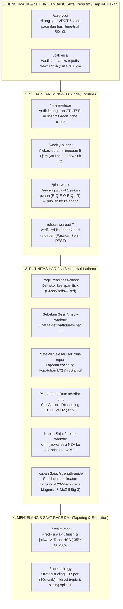

# 📖 Panduan Penggunaan AI Skills & Workflows (Slash Commands Guide)
_Intervals.icu MCP Server & Norwegian Singles Running Coach_

Dokumen ini memuat panduan komprehensif mengenai **kapan dan bagaimana** menggunakan ke-13 AI Skills (Slash Commands) yang tersedia di dalam ekosistem `intervals-icu-mcp` berbasis **Norwegian Singles Training Method** (`docs/references/norwegian-singles/`).

---

## 🗺️ Peta Alur Waktu: "Kapan Saya Harus Mengetik Perintah Ini?"



---

## 📋 Direktori 13 Slash Commands & Waktu Penggunaan

| No | Slash Command | Berkas Skill | Timeline Penggunaan | Tujuan Utama | Kebutuhan Input Pengguna |
|:--:|---|---|---|---|---|
| **1** | **`/plan-week`** | [`SKILL.md`](../.agents/skills/plan-week/SKILL.md) | **Setiap Hari Minggu Malam** | Merancang jadwal 1 pekan penuh (`E-Q-E-Q-E-Q-LR`) berbasis rasio 75/25 NSA, pratinjau tabel, dan penerbitan satu-klik ke kalender. | Opsional: target jam kustom (misal `/plan-week 6h`) atau tanggal Senin. |
| **2** | **`/readiness-check`** | [`SKILL.md`](../.agents/skills/readiness-check/SKILL.md) | **Setiap Pagi Hari** (04:30–05:30 WIB) | Evaluasi kesiapan fisik (Green/Yellow/Red) sebelum latihan, plus protokol cross-training Flag 5 Musculoskeletal Guardrail (§4.9). | Tidak ada (otomatis baca TSB, ACWR, Sleep, RHR). |
| **3** | **`/check-workout`** | [`SKILL.md`](../.agents/skills/check-workout/SKILL.md) | **Sebelum Mulai Sesi Lari** | Melihat detail target intensitas, durasi, dan watt sesi hari ini. | Opsional: rentang hari (contoh: `/check-workout 7`). |
| **4** | **`/run-report`** | [`SKILL.md`](../.agents/skills/run-report/SKILL.md) | **15–30 Menit Pasca-Lari** | Evaluasi eksekusi lari (kepatuhan LT2, watt, rest pasif, HR drift, dan fallback RPE cuaca ekstrem §4.2). | Tanggal sesi, nama sesi, skor RPE (1-10), catatan fisik. |
| **5** | **`/cardiac-drift`** | [`SKILL.md`](../.agents/skills/cardiac-drift/SKILL.md) | **Pasca-Long Run Selesai** | Memeriksa penurunan efisiensi jantung (*Aerobic Decoupling* $H_1$ vs $H_2$). | Opsional: Activity ID (default: lari terakhir). |
| **6** | **`/fitness-status`** | [`SKILL.md`](../.agents/skills/fitness-status/SKILL.md) | **Setiap Hari Minggu Malam** | Evaluasi CTL (Sustainable Fitness), TSB, ACWR, Green Zone check, dan reminder kalibrasi >8 minggu (§2.4). | Opsional: tanggal target (default: hari ini). |
| **7** | **`/weekly-budget`** | [`SKILL.md`](../.agents/skills/weekly-budget/SKILL.md) | **Setiap Hari Minggu Malam** | Menghitung budget durasi mingguan (5–9 jam) split 75/25 waktu, aturan progresi (§2.4), dan dua guardrail §6.2. | Opsional: target jam kustom (misal `/weekly-budget 6h`). |
| **8** | **`/create-workout`** | [`SKILL.md`](../.agents/skills/create-workout/SKILL.md) | **Kapan Saja Dibutuhkan** | Menerbitkan planned workout NSA terstruktur ke kalender Intervals.icu (validasi cap kerja Sub-T 40–50m §6.2). | Tanggal, nama sesi, deskripsi format Teks DSL. |
| **9** | **`/calc-nsa`** | [`SKILL.md`](../.agents/skills/calc-nsa/SKILL.md) | **Setelah Time Trial / Awal Musim** | Menghasilkan matriks interval berbasis durasi (1m s.d. 15m) resmi NSA via MCP `calculate_nsa_matrix`. | Opsional: nilai VDOT kustom (misal `/calc-nsa vdot=32`). |
| **10**| **`/calc-vdot`** | [`SKILL.md`](../.agents/skills/calc-vdot/SKILL.md) | **Setelah Tes Lari / Time-Trial** | Menghitung skor VDOT & memetakan pace Sub-T (10k, 15k, HM, 30k) untuk kalibrasi berkala 4–8 minggu (§4.3). | Jarak tempuh tes (km) dan waktu tempuh (MM:SS). |
| **11**| **`/predict-race`** | [`SKILL.md`](../.agents/skills/predict-race/SKILL.md) | **10–14 Hari Menjelang Lomba** | Prediksi waktu finish, jadwal A-Tapering, dan reassurance jarak 5K–HM sebagai sweet spot NSA (§5.1). | Jarak race, VDOT, tanggal race. |
| **12**| **`/race-strategy`** | [`SKILL.md`](../.agents/skills/race-strategy/SKILL.md) | **Race Week & Pagi Race Day** | Eksekusi race day lengkap: pacing split berbasis Critical Power (% CP), timing intake energy gel EJ Sport (30g carb), dan batas hidrasi tropis. | Target jarak/race, estimasi waktu/pace. |
| **13**| **`/strength-guide`** | [`SKILL.md`](../.agents/skills/strength-guide/SKILL.md) | **2x Seminggu (Hari Q: Selasa & Jumat Sore)** | Panduan sesi latihan kekuatan fungsional (20–25m) berbasis Steve Magness dan McGill Big 3 untuk pelari. | Opsional: fokus area/fase (misal `taper`, `mcgill`). |

---

## 🔍 Panduan Detail Situasi Penggunaan

### 1️⃣ Situasi: Penetapan Benchmark Ambang (Awal Musim / Tiap 4–8 Pekan)
Digunakan saat Anda melakukan time trial (misal 5K parkrun atau 10K TT):
- **`/calc-vdot`**: Menghitung skor VDOT terkini dan memetakan estimasi pace 10k, 15k, HM, dan 30k. Mengingatkan atlet bahwa race/TT tiap 4–8 minggu adalah anjuran resmi NSA (§2.4, §4.3) untuk kalibrasi aktual dan stimulasi neuromuskular.
- **`/calc-nsa`**: Mengonversi hasil benchmark menjadi tabel matriks kerja interval durasi resmi NSA (1m, 3m, 5-6m, 8m, 10m, 15m) berikut target Watt dan rest jalan.

---

### 2️⃣ Situasi: Evaluasi Mingguan (Setiap Hari Minggu Sore/Malam)
Digunakan untuk menutup evaluasi minggu berjalan dan menyiapkan alokasi minggu berikutnya:
1. **`/fitness-status`**:
   - Melihat tren CTL, ATL, TSB, dan Ramp Rate aktual mingguan.
   - Memeriksa apakah atlet berada di dalam *Green Zone* atau memerlukan *adaptive deload*.
   - Memeriksa usia kalibrasi VDOT (apakah sudah $> 8$ minggu).
2. **`/weekly-budget`**:
   - Menghitung total durasi latihan yang aman (5–9 jam/minggu).
   - Memastikan durasi kerja Sub-Threshold tepat di koridor **20–25% total durasi**, dan porsi Easy Run $\ge 75\%$.
   - Menerapkan aturan progresi perlahan (§2.3, §2.4) dan mengecek **Dua Guardrail Terpisah (§6.2)**: jika volume $>8$–9 jam disarankan *easy doubles*, dan waktu kerja Sub-T dibatasi maks 40–50 menit per sesi di semua level volume.
3. **`/plan-week`**:
   - Merancang jadwal 1 pekan penuh (`E-Q-E-Q-E-Q-LR`) secara otomatis dari durasi target mingguan.
   - Menampilkan tabel pratinjau lengkap dengan jam lari (pagi 05:30 & sore ngabuburit 16:45).
   - Menerbitkan batch ke-6 sesi workout ke kalender Intervals.icu secara satu-klik setelah disetujui atlet.
4. **`/check-workout 7`**:
   - Memverifikasi kalender 7 hari ke depan sudah terisi lengkap dan hari Senin terjadwal **REST TOTAL**.

---

### 3️⃣ Situasi: Rutinitas Harian Lari (Daily Cycle)
Alur yang dijalankan dari hari ke hari:

#### 🌅 A. Pagi Hari (Bangun Tidur / Sebelum Sesi)
- **`/readiness-check`**:
  - Dijalankan saat bangun tidur (04:30 – 05:00 WIB).
  - Mengevaluasi apakah tubuh siap menerima beban (GREEN) atau harus dibatasi ke Easy santai / Deload (YELLOW/RED).
  - **Flag 5 (Musculoskeletal Guardrail) [Sumber: NSA §4.9]**: Jika terdapat kekakuan/nyeri muskuloskeletal ringan tapi ingin menjaga volume aerobik, atlet diizinkan mengganti sesi lari dengan *cross-training* (sepeda statis/elliptical) pada intensitas dan durasi setara tanpa benturan sendi/spinal berlebih.
- **`/check-workout`**:
  - Membaca target sesi hari ini: durasi menit, target watt (% CP), dan batas atas denyut jantung (*HR ceiling*).

#### 🏁 B. Pasca-Lari (Setelah Data Terunggah ke Intervals.icu)
- **`/run-report`**:
  - Dijalankan 15–30 menit setelah lari selesai.
  - Memverifikasi kepatuhan terhadap batas atas intensitas LT2 (85–95% CP) dan istirahat pasif.
  - **Fallback Cuaca Ekstrem [Sumber: NSA §4.2]**: Jika cuaca sangat panas/lembap ekstrem, sistem memprioritaskan RPE yang dilaporkan atlet dibanding angka HR mentah yang terdistorsi oleh stres termal.
- **`/cardiac-drift`**:
  - Dijalankan khusus setelah sesi Long Run (> 60 menit).
  - Memastikan *Aerobic Decoupling* $< 5.0\%$ sebagai bukti efisiensi kardiovaskular.

#### 🗓️ C. Kapan Saja
- **`/create-workout`**:
  - Menjadwalkan sesi lari terstruktur menggunakan Teks DSL resmi NSA yang otomatis tersinkronisasi ke jam tangan, dengan validasi batas kerja Sub-T maks 40–50 menit per sesi (§6.2).

#### 🏋️ D. Sesi Kekuatan & Stabilitas Tulang Belakang (Selasa & Jumat Sore)
- **`/strength-guide`**:
  - Dijalankan 2x sepekan pada sore hari (16:30 WIB) setelah sesi lari Sub-T pagi dengan jeda minimal 4–6 jam (mematuhi prinsip Steve Magness *"Hard Days Hard, Easy Days Easy"*).
  - Berdurasi ringkas 20–25 menit memadukan The McGill Big 3 (proteksi stabilitas tulang belakang via piramida 6-4-2 tahan 7s), penguatan panggul/tendon pelari, dan *neuromuscular strides*.

---

### 4️⃣ Situasi: Menjelang Hari Perlombaan & Race Day
Digunakan saat fase puncak persiapan lomba hingga pagi hari race:
- **`/predict-race`** (10–14 Hari Pra-Lomba):
  - Menghitung prediksi waktu finish realistis berbasis VDOT dan kebugaran CTL.
  - Menghasilkan jadwal *A-Taper* NSA (Minggu Taper 1: volume 75%, Race Week: volume 50% dengan frekuensi tetap).
  - **Reassurance Target HM [Sumber: NSA §5.1]**: Menegaskan bahwa jarak 5K–HM adalah *sweet spot* utama NSA, sehingga atlet cukup menjalankan Long Run santai 75–90 menit tanpa perlu simulasi tempo-in-LR maraton.
- **`/race-strategy`** (Race Week & Pagi Hari Lomba):
  - Menghitung strategi split pacing Critical Power (% CP) 3 segmen (Controlled Start KM 1–3, Steady Cruise KM 4–17, Controlled Push KM 18–21.1).
  - Menghitung jadwal intake energy gel resmi atlet: **EJ Sport Energy Gel (30g karbohidrat)** (T-15m, KM 6, KM 12, KM 17) dengan total 120g carbs.
  - Mengkalkulasi estimasi keringat iklim tropis Yogyakarta (26°C, RH 80%) dan menetapkan batas asupan cairan lambung aman (*gastric emptying limit*) 500–700 ml/jam guna menghindari *sloshing* & hiponatremia.

---

## ⚡ Quick Cheat Sheet (Hafalan Cepat)

```text
🌅 Pagi Hari (Bangun Tidur)   ➔  /readiness-check
👟 Sebelum Berangkat Lari     ➔  /check-workout
🏁 Setelah Selesai Lari        ➔  /run-report
📈 Pasca-Long Run              ➔  /cardiac-drift
📅 Minggu Sore / Malam         ➔  /fitness-status  lalu  /weekly-budget
🗓️ Menjadwalkan Sesi Baru      ➔  /create-workout
⏱️ Update Benchmark            ➔  /calc-vdot  lalu  /calc-nsa
🏆 10-14 Hari Dekat Lomba      ➔  /predict-race
⚡ Taktis & Fueling Race Day   ➔  /race-strategy
🏋️ Sesi Latihan Kekuatan       ➔  /strength-guide
```
