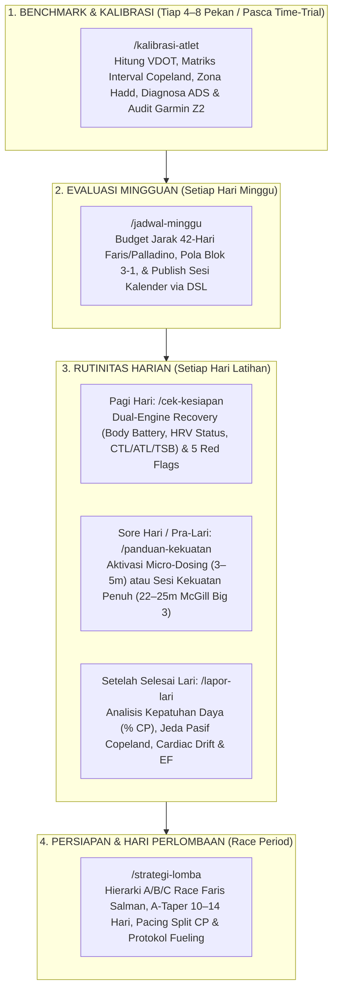

# 📖 Panduan Penggunaan AI Skills & Workflows (Slash Commands Guide)
_Intervals.icu MCP Server & Running Coach Intelligence (Dual-Engine Ecosystem)_

Dokumen ini memuat panduan komprehensif mengenai **kapan dan bagaimana** menggunakan ke-6 Unified AI Skills (Slash Commands) yang tersedia di dalam ekosistem `intervals-icu-mcp` yang mengintegrasikan telemetri **Intervals.icu** dan **Garmin Connect** dengan sains fisiologi daya tahan (*Norwegian Singles Method*, *John Hadd*, *Faris Salman*, *Steve Magness*, dan *Dr. Stuart McGill*).

---

## 🗺️ Peta Alur Waktu: "Kapan Saya Harus Mengetik Perintah Ini?"

---

## 📋 Matriks Ringkas 6 Perintah Cepat

| Perintah | Frekuensi | Masukan Pengguna (Contoh) | Sumber Data & Engine | Output Utama |
|---|---|---|---|---|
| [`/cek-kesiapan`](../.agents/skills/cek-kesiapan/SKILL.md) | **Setiap Pagi** | `/cek-kesiapan` *(otomatis)* | Garmin (Body Battery, HRV) + Intervals.icu (TSB, ACWR, Sleep) | Status Kesiapan (0–100% HIJAU/KUNING/MERAH), Rekomendasi Hari Ini, Deteksi 5 Red Flags |
| [`/lapor-lari`](../.agents/skills/lapor-lari/SKILL.md) | **Pasca Lari** | `/lapor-lari` atau `/lapor-lari i12345` | Intervals.icu (Streams, Details, Intervals, Gear) | Telemetri Daya (% CP), Kepatuhan LT2 Copeland, Aerobic Decoupling EF (< 5%), Jeda Pasif |
| [`/jadwal-minggu`](../.agents/skills/jadwal-minggu/SKILL.md) | **Hari Minggu** | `/jadwal-minggu` atau `/jadwal-minggu 2026-11-02` | Intervals.icu (History 42 hari, Planned Events, Athlete Profile) | Rolling Budget 42 Hari Faris/Palladino, Distribusi Norwegian Singles, Penerbitan DSL Kalender |
| [`/kalibrasi-atlet`](../.agents/skills/kalibrasi-atlet/SKILL.md) | **Tiap 4–8 Pekan** | `/kalibrasi-atlet 5k 24:30` | Intervals.icu (VDOT, Zones) + Garmin Connect (Audit Z2/LTHR) | Angka VDOT Terkini, Matriks Copeland (Fast/Med/Long), Zona Hadd, Diagnosa Spektrum ADS |
| [`/panduan-kekuatan`](../.agents/skills/panduan-kekuatan/SKILL.md) | **2x Seminggu / Tiap Hari** | `/panduan-kekuatan` | Magness Neural Adaptation + McGill Big 3 + Running Anatomy | Checklist Sesi Penuh (22–25m) atau Aktivasi Micro-Dosing (3–5m) tanpa risiko kompresi spinal |
| [`/strategi-lomba`](../.agents/skills/strategi-lomba/SKILL.md) | **1–4 Pekan Pra-Race** | `/strategi-lomba 10k 2026-11-15 A-Race` | Intervals.icu (Race Predictor, Taper Plan, Fueling Calculator) | Strategi Prioritas A/B/C Race, Protokol Tapering, Matriks Pacing Berbasis Daya (% CP), Jadwal Fueling Gel |

---

## 🛠️ Detail Alur Kerja 6 Skills

### 1. `/cek-kesiapan` (Daily Readiness & Dual-Engine Health)
- **Kapan Digunakan**: Setiap pagi hari sebelum memulai aktivitas fisik atau sebelum menentukan apakah sesi lari hari ini dapat dieksekusi sesuai rencana.
- **Cara Kerja**:
  1. Mengambil skor *Body Battery* dan status *HRV* semalam dari `garmin-connect` MCP.
  2. Mengambil metrik kelelahan kronis (*TSB*, *ACWR*, *Sleep Duration*, *Resting HR*) dari `intervals-icu` MCP.
  3. Menguji 5 Red Flags kelelahan (RHR naik $>5$ bpm, tidur buruk 2 malam, kehilangan motivasi/CNS fatigue, HRV status rendah, Body Battery pagi $<50$).
  4. Menghasilkan skor komposit pemulihan (0–100%) dan memberikan lampu hijau, kuning, atau merah bagi sesi latihan hari ini.

### 2. `/lapor-lari` (Post-Workout Evaluation & Telemetry Audit)
- **Kapan Digunakan**: Segera setelah menyelesaikan aktivitas lari dan data telah tersinkronisasi ke Intervals.icu.
- **Cara Kerja**:
  1. Mengambil detail aktivitas, split lap/interval, dan telemetri detik-per-detik (*watts*, *heart rate*, *cadence*, *velocity*).
  2. Mengaudit kepatuhan ambang batas *Sub-Threshold* Copeland (% CP) dan memastikan jeda istirahat dilakukan secara pasif (jalan santai/berdiri).
  3. Menghitung stabilitas kardiovaskular melalui *Aerobic Decoupling* / *Cardiac Drift* ($< 5\%$ target ideal).
  4. Memberikan umpan balik langsung ke aktivitas kalender Intervals.icu via `add_activity_message`.

### 3. `/jadwal-minggu` (Weekly Periodization & DSL Publishing)
- **Kapan Digunakan**: Setiap hari Minggu sore/malam untuk menyusun agenda sepekan ke depan.
- **Cara Kerja**:
  1. Menghitung rata-rata beban latihan lari 42 hari terakhir (*Rolling 42-Day Budget*) menggunakan algoritma Faris Salman & Steve Palladino untuk mencegah lonjakan volume akut.
  2. Menerapkan pola blok periodisasi 3-1 (*3 Build Weeks, 1 Deload Week*).
  3. Membagi porsi latihan mingguan ke dalam prinsip Norwegian Singles: 75–80% lari aerobik santai (*Easy*) dan 20–25% ambang sub-maksimal (*Sub-Threshold*).
  4. Menerbitkan rencana latihan langsung ke kalender Intervals.icu menggunakan Teks DSL terstandarisasi.

### 4. `/kalibrasi-atlet` (Periodic Fitness Benchmark & Aerobic Audit)
- **Kapan Digunakan**: Setiap 4–8 minggu sekali pasca atlet menyelesaikan tes lapangan (misal *Hadd 2400m test*, *5K/10K Time Trial*, atau perlombaan resmi).
- **Cara Kerja**:
  1. Menghitung VDOT Jack Daniels terbaru via `calculate_vdot` dan memperbarui zona kecepatan lari.
  2. Menghasilkan matriks interval Copeland (*Fast*, *Medium*, *Long*) disetel 5–25 detik lebih lambat dari Threshold VDOT.
  3. Mendiagnosis integritas fondasi aerobik atlet melalui *Uphill Athlete 10% Rule* dan *Horwill's Rule* via `diagnose_aerobic_base` untuk mendeteksi *Aerobic Deficiency Syndrome (ADS)*.
  4. Menghitung zona absolut John Hadd via `calculate_hadd_zones` dan mengaudit keselarasan zona detak jantung Garmin Connect.

### 5. `/panduan-kekuatan` (Strength Training & Kinetic Chain Protection)
- **Kapan Digunakan**: Sesi sore pada hari latihan kualitas (*Hard Days Hard*) atau pagi hari pra-lari (*Daily Micro-Dosing*).
- **Cara Kerja**:
  1. Menyediakan protokol perlindungan tulang belakang bebas beban kompresi/fleksi berulang (*McGill Big 3*: Modified Curl-Up, Side Plank, Bird-Dog).
  2. Melatih rantai kinetik penopang impak lari (*Soleus*, *Hamstring eccentric*, *Quadriceps*, *Gluteus Medius*).
  3. Mengingatkan prinsip rekrutmen saraf Steve Magness (*"Stay Tall When Tired"*).

### 6. `/strategi-lomba` (Race Strategy, Tapering & Fueling)
- **Kapan Digunakan**: 1 hingga 4 pekan menjelang ajang perlombaan hingga pagi hari lomba.
- **Cara Kerja**:
  1. Mengklasifikasikan lomba ke dalam hierarki Coach Faris Salman (*A-Race All-out*, *B-Race Tune-Up*, *C-Race Gladi Resik*).
  2. Menghitung proyeksi waktu finish via `predict_race_time` dengan penyesuaian iklim tropis/panas.
  3. Merancang jadwal *A/B/C Taper Plan* via `calculate_taper_plan` (penurunan volume bertahap tanpa memangkas frekuensi).
  4. Memetakan strategi daya (*pacing pita daya % CP*) dan jadwal nutrisi gel karbohidrat/hidrasi via `calculate_race_fueling`.
