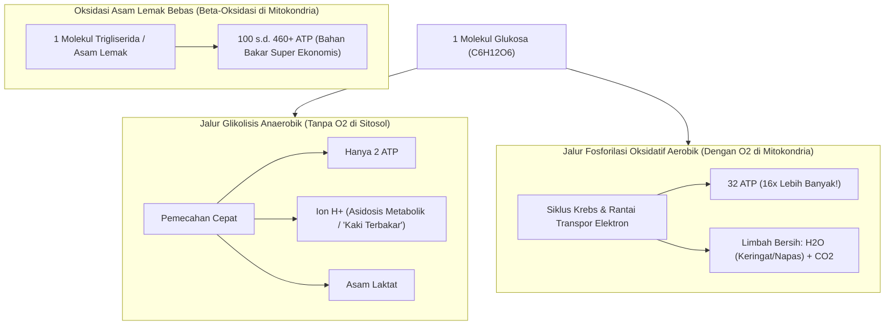
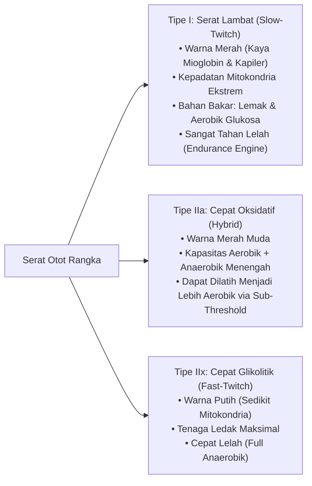
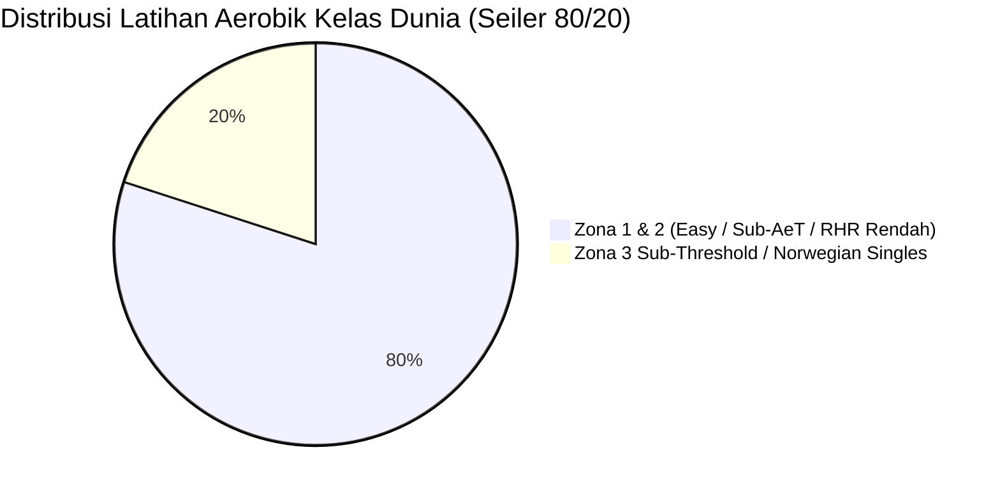

# Sistem Energi: Membangun Mesin Aerobik yang Lebih Besar (*Energy Systems: Build The Bigger Engine*)

* **Sumber Materi**: Seri Infografis Fisiologi & Sains Lari oleh **@ramadhanabs** (*Energy Systems: Build The Bigger Engine*)
* **Rujukan Teori**: Dr. Stephen Seiler (Polarized Training 80/20), John Holloszy (Mitochondrial Biogenesis), Jack Daniels, Ph.D.
* **Fokus Utama**: Pemahaman 3 sistem bioenergetika tubuh, biokimia pembentukan ATP (32 vs 2 ATP), dominasi 97% aerobik di nomor 10K, karakteristik serat otot lambat (Tipe I), dan adaptasi kapilarisasi mitokondria.
* **Status**: Dokumen Rujukan Fondasi Fisiologis untuk Evaluasi Sesi Lari, Perencanaan Volume, dan Target Lomba.

---

## 1. Tiga Sistem Energi Tubuh Manusia (*The Three Energy Systems*)

Dalam setiap langkah lari, otot rangka membutuhkan molekul berenergi tinggi yang disebut **Adenosin Trifosfat (ATP)** sebagai bahan bakar kontraksi aktin-miosin. Karena simpanan ATP bebas di dalam sel otot hanya cukup untuk 1–2 detik kontraksi, tubuh menggunakan tiga sistem metabolisme utama untuk meregenerasi ATP:

| Parameter | 1. ATP-PCr (*Phosphagen System*) | 2. Glikolisis Anaerobik (*Lactic System*) | 3. Sistem Aerobik (*Oxidative System*) |
|---|---|---|---|
| **Ketersediaan Oksigen ($O_2$)** | Anaerobik (Tanpa Oksigen) | Anaerobik (Tanpa Oksigen) | **Aerobik (Memerlukan Oksigen)** |
| **Bahan Bakar Utama** | Fosfokreatin (PCr) tersimpan | Glikogen otot & Glukosa darah | **Glukosa, Glikogen, & Asam Lemak Bebas (Trigliserida)** |
| **Lokasi Reaksi Seluler** | Sitosol / Sitoplasma sel | Sitosol / Sitoplasma sel | **Matriks & Membran Dalam Mitokondria** |
| **Durasi Daya Maksimal** | 0 – 10 detik | 10 – 60 detik (puncak pada 30–45 detik) | **2 menit hingga berjam-jam/berhari-hari** |
| **Laju Pembentukan Power** | Sangat Cepat (Eksplosif) | Cepat | Lambat namun Berkelanjutan (*Sustained Engine*) |
| **Kapasitas Cadangan Energi** | Sangat Terbatas | Terbatas (Menghasilkan asidosis metabolik) | **Nyaris Tanpa Batas (Cadangan Lemak Tubuh)** |
| **Limbah Hasil Sampingan** | Kreatin bebas, Pi (Fosfat anorganik) | Laktat + Ion Hidrogen ($H^+$) $\rightarrow$ Asidosis | **Air ($H_2O$) & Karbondioksida ($CO_2$)** |
| **Contoh Aktivitas Lari** | Sprint all-out 60–100 m, loncatan plyometrik | Lari 400 m, kick finish 200 m terakhir | **Easy Run, Sub-Threshold, 5K, 10K, HM, Marathon** |

---

## 2. Biokimia Pembentukan ATP: Perbandingan Efisiensi 32 vs 2 ATP

Salah satu prinsip fisiologi terpenting bagi pelari jarak jauh adalah memahami perbedaan radikal efisiensi produksi energi antara jalur anaerobik dan jalur aerobik:

### Intisari Pembakaran:
1. **Glikolisis Anaerobik = 2 ATP per Glukosa**:
   - Jalur "darurat" yang sangat tidak efisien.
   - Mengonsumsi glikogen secara boros dan melepaskan ion $H^+$ yang menurunkan pH darah (asidosis), menghambat enzim glikolitik, dan mematikan fungsi jembatan silang miosin-aktin dalam hitungan puluhan detik.
2. **Respirasi Aerobik Glukosa = 30 hingga 32 ATP per Glukosa**:
   - Menghasilkan energi **15–16 kali lipat lebih banyak** dari molekul glukosa yang sama melalui Siklus Krebs dan Rantai Transpor Elektron di dalam mitokondria.
   - *Catatan Biokimia Modern*: Buku teks biologi lama sering menyebut 36–38 ATP. Konsensus biokimia modern (Lehninger, Berg & Stryer) menetapkan angka **30–32 ATP** bersih per molekul glukosa karena rasio P/O riil mitokondria adalah $\sim 2.5\text{ ATP per NADH}$ dan $\sim 1.5\text{ ATP per }\text{FADH}_2$.
   - Limbahnya murni air ($H_2O$) dan karbon dioksida ($CO_2$) yang dengan mudah dikeluarkan lewat pernapasan dan keringat.
3. **Beta-Oksidasi Lemak Aerobik = 100 hingga 460+ ATP**:
   - Pelari dengan berat 70–80 kg menyimpan sekitar 60.000 hingga 100.000 kkal energi dalam bentuk lemak, cukup untuk berlari ratusan kilometer tanpa henti jika mesin oksidasi lemak aerobiknya terlatih dengan baik.

---

## 3. Kontribusi Sistem Energi Berdasarkan Jarak Balapan (*Race Distance Dynamics*)

Banyak pelari keliru menganggap bahwa nomor 5K dan 10K adalah perlombaan cepat yang dominan mengandalkan anaerobik. Data sains fisiologi olahraga menunjukkan kenyataan yang berlawanan:

| Jarak Lomba | Waktu Tempuh Tipikal | Kontribusi Aerobik (%) | Kontribusi Anaerobik (%) | Relevansi Fisiologis |
|:---:|:---:|:---:|:---:|---|
| **800 meter** | 1:40 – 2:30 | **60%** | 40% | Batas transisi daya tahan anaerobik-aerobik |
| **1.500 m / 1 Mile** | 3:30 – 5:30 | **77%** | 23% | Sistem aerobik sudah mulai mendominasi $3/4$ energi |
| **5.000 meter (5K)** | 13:00 – 30:00 | **90%** | 10% | Dominasi mutlak kapasitas kardiorespirasi & $\text{VO}_2\max$ |
| **10.000 meter (10K - Elit)** | 26:30 – 32:00 | **97%** | **3%** | Standar atlet profesional kecepatan tinggi |
| **10.000 meter (10K - Rekreasional)** | **50:00 – 70:00** | **98.5% – 99%** | **1% – 1.5%** | **Pondasi balapan Semarang 10K (Durasi 55–65 menit): 98.5% aerobik!** |
| **Half Marathon (21.1K)**| 1:00 – 2:30 | **99%** | 1% | Keterbatasan ditentukan oleh efisiensi glikogen dan ambang laktat |
| **Marathon (42.2K)** | 2:02 – 5:00 | **99.5%** | 0.5% | Murni mesin pembakaran lemak dan integritas mitokondria |

> [!IMPORTANT]
> **Fakta Krusial untuk Pelari 10K Rekreasional (Semarang 10K)**:
> Angka 97% aerobik di infografis adalah patokan untuk atlet elit yang berlari sub-30 menit. Bagi pelari rekreasional yang menempuh 10K dalam 55 hingga 65 menit (seperti benchmark Bandoeng 10K Anda 1:04:56), durasi kontraksi otot berlangsung dua kali lebih lama. Secara bioenergetika, **kontribusi sistem aerobik Anda justru meningkat menjadi 98.5% hingga 99%**! 
> 
> Ketergantungan Anda pada mesin aerobik bersifat mutlak. Menyia-nyiakan waktu latihan dengan sprint anaerobik all-out hanya melatih kontribusi yang kurang dari 1.5% dari total durasi lomba Anda.

---

## 4. Karakteristik Serat Otot (*Muscle Fiber Types*)

Otot rangka manusia tersusun atas kombinasi tiga jenis serat otot dengan fungsi metabolik yang kontras:

### Komposisi Atlet Jarak Jauh & Peran Serat Hybrid (Tipe IIa):
- Rata-rata pelari jarak menengah dan jauh yang terlatih memiliki **70% hingga 80% serat Tipe I (Slow-Twitch)**.
- **Tujuan Ganda Latihan Aerobik Komprehensif**:
  1. *Lari Santai (Easy Run / $\le \text{HR}_{\max} - 50$)* melatih 70% serat Tipe I memaksimalkan beta-oksidasi lemak.
  2. *Sesi Sub-Threshold (Norwegian Singles & Hadd)* merekrut serat **Tipe IIa (Hybrid)** dan melatih mitokondrianya untuk mengonsumsi asam laktat sebagai bahan bakar, mengubah serat cepat menjadi mesin aerobik sekunder yang sangat efisien!

---

## 5. Adaptasi Fisiologis dari Latihan Aerobik Berkelanjutan

Latihan lari aerobik berdurasi konsisten memicu 4 adaptasi fisik dan seluler mendalam yang tidak bisa didapatkan melalui latihan interval pendek:

1. **Hipertrofi Eksentrik Ventrikel Kiri Jantung**:
   - Ruang bilik ventrikel kiri jantung melebar, memungkinkan jantung menampung dan memompa volume darah yang jauh lebih besar per denyutan (*Stroke Volume* meningkat).
   - Efek klinis: Denyut jantung istirahat (*Resting Heart Rate* / RHR) menurun drastis karena jantung bekerja jauh lebih efisien.
2. **Angiogenesis / Peningkatan Kapilarisasi**:
   - Pembentukan jaringan pembuluh darah kapiler baru yang mengelilingi setiap serabut otot aktif.
   - Efek klinis: Difusi molekul oksigen dan pembuangan sisa metabolik berlangsung secara instan di tingkat seluler.
3. **Biogenesis Mitokondria (Holloszy 1967 & Dudley 1982)**:
   - Volume, ukuran, dan densitas mitokondria di dalam sel otot meningkat hingga 40–100%. Pabrik pembentukan 32 ATP bertambah secara massal.
4. **Peningkatan Enzim Oksidatif & Efisiensi Lemak**:
   - Aktivitas enzim Sitrat Sintase dan Suksinat Dehidrogenase meningkat tajam, melipatgandakan kemampuan tubuh membakar lemak sebagai sumber energi utama dan menghemat simpanan glikogen otot untuk fase akhir perlombaan.

---

## 6. Distribusi Intensitas Polarized / Pyramidal (Dr. Stephen Seiler 80/20)

Riset luas Dr. Stephen Seiler terhadap atlet daya tahan kelas dunia di berbagai cabang (lari, ski lintas alam, dayung, sepeda) membuktikan pola universal keberhasilan jangka panjang:

* **80% Volume Berada di Zona 1 / Zona 2 (Easy Running / $\le \text{HR}_{\max} - 50\text{ bpm}$)**:
  - Intensitas di bawah Ambang Aerobik ($\text{AeT}$ / LT1).
  - Memberikan stimulasi biologis maksimal untuk pembentukan kapiler darah dan mitokondria dengan tingkat kelelahan sistem saraf simpatik (ANS) yang minimal.
* **20% Volume Berada di Zona 3 (Sub-Threshold / Norwegian Singles)**:
  - Intensitas terkontrol tepat di antara LT1 dan LT2 (laktat 2.0–3.5 mmol/L).
  - Mengasah ambang laktat dan kecepatan spesifik lomba tanpa mengorbankan pemulihan harian.
* **Bahaya "Grey Zone" / "No Man's Land"**:
  - Berlari terlalu kencang di hari santai (berada di atas $\text{AeT}$ tetapi di bawah $\text{LT2}$) memicu kelelahan sistem saraf yang tinggi tanpa memberikan adaptasi kapiler tambahan yang sepadan. Pelari menjadi terlalu lelah untuk sesi kualitas berikutnya dan menghambat kematangan basis aerobiknya.

---

## 7. Rangkuman Aksi untuk Atlet

1. **Pahami Prioritas Balapan**: Semarang 10K adalah perlombaan dengan tuntutan **97% energi aerobik**. Jangan terjebak obsesi latihan sprint anaerobik yang hanya menyumbang 3%.
2. **Kembangkan 70% Serat Lambat**: Lakukan mayoritas kilometer mingguan pada zona Easy yang benar-benar santai ($\le \text{HR}_{\max} - 50\text{ bpm}$) agar serat Tipe I beradaptasi optimal.
3. **Bangun Pabrik Mitokondria Terlebih Dahulu**: Kapasitas mesin yang besar (*Bigger Engine*) adalah prasyarat mutlak sebelum Anda bisa memacu mobil balap Anda pada kecepatan tinggi secara konsisten.
