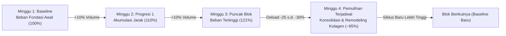

# Membangun Basis: Volume Terlebih Dahulu, Kecepatan Kemudian (*Base Building: Volume First. Speed Later*)

* **Sumber Materi**: Seri Infografis Fisiologi & Sains Lari oleh **@ramadhanabs** (*Base Building: Volume First. Speed Later*)
* **Rujukan Teori**: Dr. Stephen Seiler, Steve Magness (*The Science of Running*), Dr. Phil Maffetone, Tim Noakes (*Lore of Running*)
* **Fokus Utama**: Dinamika pergeseran kurva laktat (*The Bend*), disparitas laju adaptasi jaringan (*The Risk Window*), periodisasi Blok 3+1 (+10% ramp & -30% deload), dan keunggulan biologis frekuensi 5–6 hari per minggu.
* **Status**: Dokumen Rujukan Perancangan Siklus Latihan, Anggaran Jam Mingguan (*Weekly Budget*), dan Pencegahan Cedera Muskuloskeletal.

---

## 1. Filosofi Dasar: Mengapa Volume Harus Mendahului Kecepatan?

Banyak pelari tergoda untuk langsung memasukkan sesi interval kencang (*speedwork*) atau tempo cepat sejak minggu pertama latihan dengan asumsi bahwa "agar bisa lari cepat saat balapan, kita harus sering berlari cepat saat latihan". 

Secara sains fisiologi, logika ini terbalik. Kecepatan tanpa fondasi aerobik yang kokoh adalah **kecepatan yang rapuh dan berumur pendek**. Volume aerobik berintensitas rendah (*Easy running*) bukan sekadar "pengisi kilometer", melainkan fondasi struktural yang memperluas kapasitas mesin Anda:

1. **Volume Membangun Kapasitas Oksigen**: Meningkatkan volume darah dan kapasitas difusi oksigen di jaringan kapiler.
2. **Volume Memperbanyak Mesin Mitokondria**: Memberi ruang dan pabrik ATP yang memadai untuk menopang kecepatan tinggi kelak.
3. **Volume Menanamkan Efisiensi Mekanis (*Running Economy*)**: Langkah kaki menjadi lebih rileks dan hemat energi melalui ribuan repetisi motorik tanpa gangguan asam laktat.

> [!NOTE]
> **Penyelarasan Filosofi: "Speed Later" vs Norwegian Singles (NSA)**:
> - Pendekatan tradisional Lydiard mengartikan base building sebagai "hanya lari santai berbulan-bulan tanpa latihan kualitas sama sekali".
> - Dalam metodologi modern **Norwegian Singles Training Method**, latihan **Sub-Threshold terkontrol (Card A: 3m reps, laktat 2.0–3.0 mmol/L, 85–90% CP) TETAP DIJALANKAN sepanjang tahun (*Year-Round Consistency*)** sebanyak 20–22% porsi mingguan.
> - Yang dimaksud *"Speed Later"* (ditunda) adalah **latihan anaerobik all-out (sprint laktat tinggi $>4.0\text{ mmol/L}$, VO₂max all-out)**. Sub-Threshold terkontrol bukanlah ancaman bagi tendon, melainkan stimulus vital yang menjaga efisiensi enzim pengurai laktat tanpa membakar glikogen berlebih.

---

## 2. Dinamika Kurva Laktat: Menggeser Titik Kelengkungan (*The Bend*)

Laktat darah bukanlah racun, melainkan bahan bakar metabolik perantara. Namun, akumulasi laktat menandakan bahwa laju produksi glikolisis telah melampaui kapasitas mitokondria untuk membersihkannya (*lactate clearance*):

```mermaid
xychart-beta
    title "Pergeseran Kurva Laktat (The Bend) Berkat Latihan Volume Aerobik"
    x-axis "Pace / Intensitas (% VO2max)" [50%, 60%, 70%, 75%, 80%, 85%, 90%]
    y-axis "Konsentrasi Laktat Darah (mmol/L)" 0 --> 10
    line "Sebelum Base Building (The Bend di 60%)" [1.2, 1.8, 3.5, 5.0, 7.2, 9.5, 11.0]
    line "Setelah Base Building (The Bend Bergeser ke 80%)" [1.0, 1.1, 1.3, 1.8, 2.5, 4.2, 7.8]
```

### Fenomena "The Bend" (Titik Tekuk):
- **Sebelum Base Building**:  
  Pada intensitas santai (55–60% $\text{VO}_2\max$), kurva laktat sudah mulai melengkung tajam ke atas (*The Bend*). Pelari memproduksi laktat terlalu dini, sehingga kecepatan lari terasa berat meski baru berada di pace sedang.
- **Setelah Base Building (Volume Aerobik Matang)**:  
  Kepadatan mitokondria dan enzim pembersih laktat meningkat. Kurva laktat tetap mendatar lebih lama dan titik kelengkungan bergeser jauh ke kanan (*Rightward shift*) dari 55% menuju **75%–80% $\text{VO}_2\max$**.
- **Dampak Nyata di Lapangan**:  
  Pelari sanggup berlari pada kecepatan yang jauh lebih kencang (misal dari 6:30 /km ke 5:15 /km) dengan kadar denyut jantung dan asam laktat darah yang tetap rendah dan stabil!

---

## 3. Disparitas Waktu Adaptasi Biologis: "Jendela Risiko" (*The Risk Window*)

Alasan nomor satu mengapa pelari mengalami cedera saat menambah porsi latihan adalah ketidaktahuan mengenai **perbedaan kecepatan adaptasi antar-jaringan tubuh manusia**:

```mermaid
gantt
    title Linimasa Adaptasi Jaringan Tubuh terhadap Beban Lari
    dateFormat  X
    axisFormat %s mgg

    section Sistem Kardiovaskular (Cepat)
    Jantung, Paru, & Volume Plasma Darah :active, 0, 12

    section Sistem Otot & Mitokondria (Sedang)
    Hipertrofi Otot & Enzim Oksidatif     :active, 0, 20

    section Sistem Muskuloskeletal (Sangat Lambat)
    Remodeling Tulang Kortikal            :crit, 0, 26
    Tendon Achilles, Patella, & Fasia Kaki:crit, 0, 52
```



| Jaringan Tubuh | Suplai Pembuluh Darah (Vaskularisasi) | Waktu Adaptasi Nyata | Persepsi Atlet di Lapangan |
|---|:---:|:---:|---|
| **Jantung & Paru-Paru** | Sangat Kaya (Aliran darah masif) | **6 – 12 Minggu** | *"Napas terasa sangat enteng, paru-paru tidak sesak lagi."* |
| **Otot Rangka & Mitokondria**| Kaya pembuluh kapiler | **12 – 20 Minggu** | *"Kaki terasa kuat dan tidak cepat pegal setelah lari santai."* |
| **Tendon, Tulang, & Ligamen** | **Sangat Minim (Avaskular / Rendah)** | **3 – 10+ Bulan s.d. 1–2 Tahun** | Jaringan ikat kolagen belum siap menahan beban impak ribuan langkah berulang! |

### Jebakan "The Risk Window" (Minggu ke-6 hingga ke-12):
Pada minggu ke-6 hingga ke-12, sistem kardiovaskular sudah beradaptasi penuh. Pelari merasa dirinya "sudah sangat fit" dan tergoda memacu kecepatan atau melonjakkan jarak tempuh secara serampangan. 

Namun pada fase ini, **tendon dan tulang rawan masih rapuh**. Akibatnya timbul rentetan cedera *overuse* klasik:
- *Shin Splints* (Sindrom Stres Tibia Medial)
- *Plantar Fasciitis* (Radang fasia telapak kaki)
- *Achilles Tendinopathy* (Iritasi tendon tumit)
- *Patellar Tendinitis / Runner's Knee* (Nyeri tempurung lutut)

> [!WARNING]
> **Hukum Perlindungan Jaringan**:
> Jangan pernah mengukur kesiapan fisik Anda hanya dari entengnya napas atau rendahnya detak jantung. Berikan waktu minimal 3–6 bulan bagi tendon dan tulang kaki Anda untuk beradaptasi dengan impak mekanis sebelum memperkenalkan sesi interval cepat bervolume tinggi.

---

## 4. Periodisasi Base Building: Pola Blok 3+1

Untuk menaikkan kapasitas aerobik tanpa menabrak batas ketahanan tendon, terapkan pola periodisasi **Blok 3+1**:



### Aturan Eksekusi Blok 3+1:
1. **Minggu 1 (Baseline)**: Menetapkan beban durasi dasar yang nyaman dan terukur (misal 5 jam 00 menit).
2. **Minggu 2 (Ramp +10% Durasi)**: Tambahkan volume total maksimal **$+10\%$ berbasis WAKTU/DURASI** (misal menjadi 5 jam 30 menit). 
   - 🛑 **Wajib Berbasis Waktu (Hours/Minutes), BUKAN Jarak (Km)**: Jika pelari menaikkan target jarak kilometer, mereka kerap tergoda berlari lebih kencang agar jarak cepat selesai. Sel otot dan tendon manusia merespons *lama waktu menahan beban (time-under-tension)* dan jumlah impak langkah, bukan jarak GPS.
3. **Minggu 3 (Puncak Blok +10% Durasi)**: Puncak beban kerja blok tersebut (misal menjadi ~6 jam 00 menit).
4. **Minggu 4 (Deload Terjadwal -25% s.d. -30%)**:
   - Turunkan total durasi lari mingguan sebesar **25% hingga 30%** (kembali ke ~4 jam 15 menit).
   - **Pertahankan frekuensi lari** (tetap lari 4–5 hari seminggu, tetapi perpendek durasi tiap sesinya).
   - *Fungsi Fisiologis*: Memberikan jendela superkompensasi bagi kolagen tendon, menghidrasi fasia, dan meredam kelelahan sistem saraf simpatik sebelum memasuki blok latihan berikutnya.

### Indikator Pengawasan Tendon di Intervals.icu (*The Science of Workload Monitoring*):
Untuk memastikan kenaikan volume di *The Risk Window* (minggu 6–12) tidak merusak tendon:
- **ACWR (*Acute:Chronic Workload Ratio*)**: Pertahankan rasio beban akut (7 hari) terhadap beban kronis (28 hari) di zona aman **0.80 – 1.30** (*The Sweet Spot*, Tim Gabbett 2016). Nilai ACWR $> 1.50$ menandakan bahaya cedera *overuse*.
- **Ramp Rate CTL**: Batasi kenaikan CTL (*Chronic Training Load*) maksimal **$+5 \text{ s.d. } +8\text{ poin per minggu}$** di grafik fitness Intervals.icu.

---

## 5. Frekuensi vs Durasi Sekali Lari (*Frequency Trumps Long Single Runs*)

Salah satu kesalahan mendasar pelari amatir adalah memadatkan target volume ke dalam 2–3 hari saja dalam seminggu (misalnya 3 hari masing-masing 90 menit). 

Sains fisiologi membuktikan bahwa **berlari 5–6 hari seminggu dengan durasi 30–50 menit jauh lebih unggul**:

| Parameter | 3 Hari $\times$ 90 Menit (Memadatkan Beban) | 5–6 Hari $\times$ 30–50 Menit (Frekuensi Tinggi) |
|---|---|---|
| **Beban Impak Mekanis per Sesi** | Sangat Tinggi ($> 12.000$ langkah sekali jalan) $\rightarrow$ Risiko mikrotrauma tendon akut | **Rendah & Aman** ($\sim 4.000\text{--}6.000$ langkah per sesi) $\rightarrow$ Jaringan pulih dalam 24 jam |
| **Sinyal Genetik Biogenesis (PGC-1$\alpha$)** | Muncul 3 kali seminggu, terputus selama berhari-hari | **Stimulasi Genetik Harian Konstan** $\rightarrow$ Mitokondria diproduksi tanpa henti |
| **Efisiensi Gerak (*Motor Skill*)** | Menurun di akhir sesi akibat kelelahan otot lokal | **Selalu Segar** $\rightarrow$ Teknik dan neuromuskular lari tetap tajam |
| **Kelelahan Saraf & Glikogen** | Menghabiskan cadangan glikogen hingga habis total | **Terkontrol Sempurna** $\rightarrow$ Atlet bangun setiap pagi dalam keadaan siap lari |

> [!TIP]
> **Aturan Emas Frekuensi**:
> Konsistensi frekuensi adalah pemicu utama adaptasi seluler. Jauh lebih baik lari santai 35 menit sebanyak 5 hari daripada memaksakan 1 kali lari panjang 2 jam lalu terkapar kelelahan selama 4 hari berikutnya.

---

## 6. Penentuan Pace: "Conversational Pace" & Batas Fisiologis

Selama fase Base Building:
- **Kecepatan Wajib Percakapan (*Conversational Pace*)**: Anda harus mampu melafalkan kalimat lengkap tanpa tersengal-sengal di tengah kalimat (*Talk Test*).
- **Plafon Denyut Jantung Hadd**:  
  $$\text{Easy Ceiling} \le \text{HR}_{\max} - 50\text{ bpm}$$
  *(Untuk atlet dengan $\text{HR}_{\max} = 207\text{ bpm}$, batas atas mutlak lari santai adalah $\le 157\text{ bpm}$).*
- Jika denyut jantung mulai merangkak melewati batas ini akibat cuaca panas atau tanjakan, **turunkan pace atau berjalan kaki sejenak** hingga HR turun kembali. Singkirkan ego kecepatan demi menjaga jalur metabolik oksidatif murni.

---

## 7. Rangkuman Aksi untuk Atlet

1. **Prioritaskan Volume Terlebih Dahulu**: Jangan terburu-buru memasukkan speedwork sebelum melewati siklus base building terstruktur selama minimal 8–12 minggu.
2. **Waspadai The Risk Window**: Di minggu 6–12 saat napas terasa enteng, kunci disiplin Anda. Jangan melipatgandakan kecepatan karena tendon Anda masih dalam fase adaptasi awal.
3. **Terapkan Blok 3+1**: Naikkan volume maksimal 10% per minggu selama 3 minggu, lalu ambil 1 minggu pemulihan aktif (deload -30%).
4. **Pilih Frekuensi (5–6 Hari Santai)**: Distribusikan kilometer ke dalam porsi-porsi lari pendek yang konsisten untuk memicu ekspresi gen mitokondria harian secara aman.
