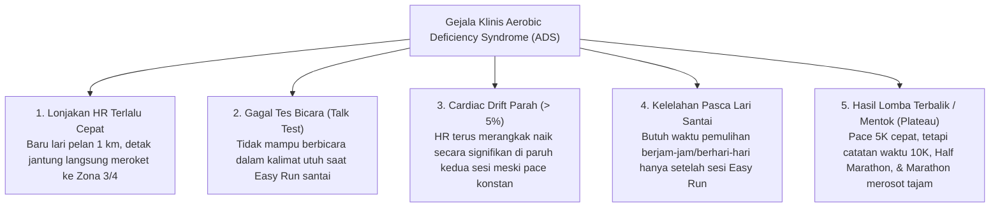
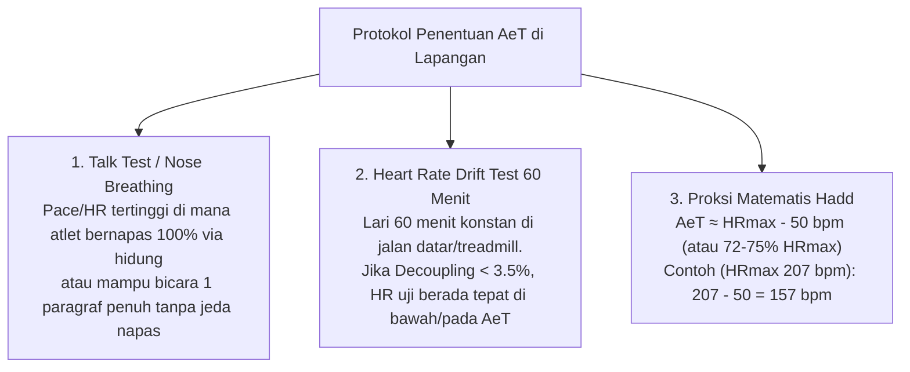
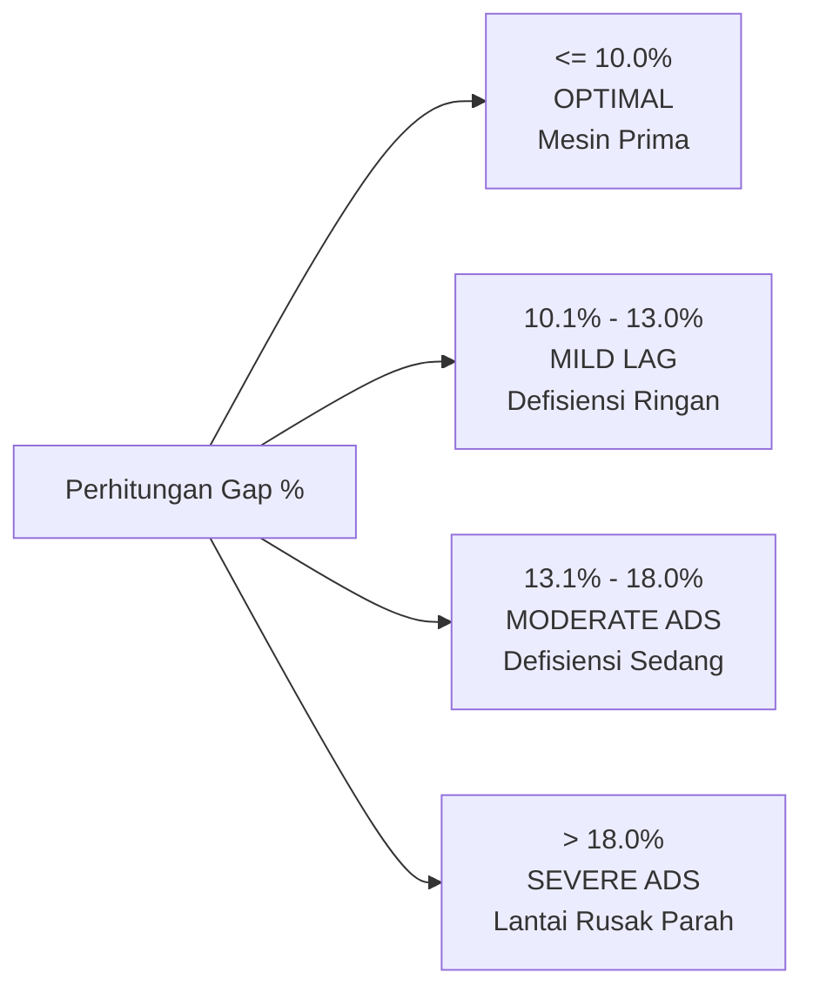
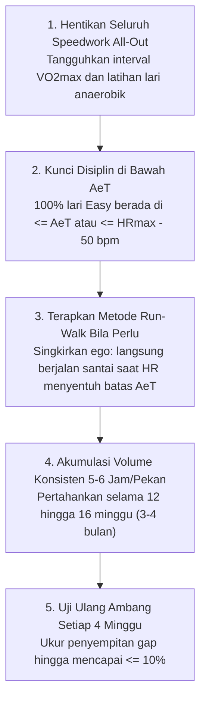

# Sindrom Defisiensi Aerobik & Aturan 10% Uphill Athlete (*Aerobic Deficiency Syndrome & The 10% Rule*)

* **Sumber Materi**: Seri Infografis Fisiologi & Sains Lari oleh **@ramadhanabs** (*Aerobic Base: Is Your Aerobic Base Broken?*)
* **Rujukan Teori**: Scott Johnston & Steve House (*Training for the Uphill Athlete*), Dr. Phil Maffetone (*The Maffetone Method*), John "Hadd" Walsh
* **Fokus Utama**: Diagnosa kuantitatif Aerobic Deficiency Syndrome (ADS), 5 sinyal klinis defisiensi aerobik, metafora "Lantai Rusak" (*The Broken Floor Analogy*), formula matematis *Uphill Athlete 10% Rule*, dan protokol pemulihan 12–16 minggu.
* **Status**: Dokumen Rujukan Diagnostik Mesin Aerobik, Penentuan Kesiapan Beban Kualitas (*Sub-Threshold Readiness*), dan Engine MCP `diagnose_aerobic_base`.

---

## 1. Apa Itu Sindrom Defisiensi Aerobik (*Aerobic Deficiency Syndrome / ADS*)?

**Aerobic Deficiency Syndrome (ADS)** adalah istilah fisiologis yang dipopulerkan oleh Scott Johnston, Steve House (*Uphill Athlete*), dan Dr. Phil Maffetone untuk mendeskripsikan kondisi di mana:

> **Sistem energi aerobik seorang atlet sangat tertinggal (*underdeveloped*) dibandingkan kapasitas sistem anaerobiknya.**

Ketika seorang pelari menderita ADS, mitokondria dan enzim oksidasi lemak di dalam serat otot lambat (Tipe I) tidak memadai untuk memenuhi kebutuhan energi bahkan pada kecepatan lari santai. Akibatnya, sistem metabolisme tubuh secara prematur "meminjam" jalur glikolisis anaerobik, membakar cadangan glikogen secara boros, dan memproduksi laktat serta ion asam pada intensitas yang seharusnya tergolong ringan.

---

## 2. Lima Sinyal Bahaya Terjadinya ADS (*The 5 Warning Signs*)

Pelari yang menderita ADS sering kali tidak menyadari kondisinya karena mereka masih merasa "bisa lari kencang di sesi interval 400 meter". Namun, tubuh memberikan 5 tanda klinis yang tidak terbantahkan:



1. **Lonjakan Denyut Jantung Dini**:  
   Baru berlari 500 meter dengan pace sangat santai, denyut jantung langsung melesat mendekati ambang laktat.
2. **Gagal Tes Bicara (*Talk Test*)**:  
   Tidak mampu mengucapkan satu atau dua kalimat penuh tanpa terengah-engah mencari oksigen saat lari santai.
3. **Penyimpangan Kardiak Parah (*Severe Cardiac Drift / Aerobic Decoupling > 5%*)**:  
   Pada paruh kedua sesi lari santai berkecepatan konstan, denyut jantung terus merangkak naik secara progresif ($>5\text{--}10\%$) karena efisiensi stroke volume jantung tidak tertopang oleh pasokan energi mitokondria.
   * *Catatan Penting Iklim Tropis (Stres Termal vs ADS Sejati)*:  
     Di iklim tropis Indonesia (suhu $28\text{--}34^\circ\text{C}$, RH $>80\%$), kenaikan HR di paruh kedua bisa dipicu oleh **mekanisme pendinginan tubuh (*thermal strain*)** dan dehidrasi ringan, bukan karena mitokondria keropos. Untuk memverifikasi ADS sejati, uji apakah *cardiac drift* tetap terjadi di lingkungan sejuk (pagi buta $<22^\circ\text{C}$ atau treadmill ber-AC).
4. **Kelelahan yang Tidak Masuk Akal Pasca Easy Run**:  
   Merasa terkuras energinya setelah lari santai 45 menit karena tubuh tanpa disadari membakar gula dan memproduksi stres metabolik layaknya habis berlomba.
5. **Kebuntuan Catatan Waktu (*Performance Plateau / Inverted Progression*)**:  
   Pelari rajin latihan interval cepat 3 kali seminggu, tetapi rekor waktu di nomor 10K, Half Marathon, dan Marathon mandek bertahun-tahun atau justru semakin lambat.

---

## 3. Protokol Lapangan Menentukan Ambang Aerobik ($\text{AeT}$) Tanpa Jarum Laktat

Salah satu kelemahan penerapan Uphill Athlete 10% Rule adalah ketidaktahuan atlet dalam menentukan titik $\text{AeT}$ secara presisi. Berikut 3 protokol lapangan (*Field Test Protocols*) yang terbukti valid secara saintifik:



1. **Nose-Breathing & Conversational Talk Test**:
   - Berlari santai dengan mulut tertutup rapat, bernapas murni melalui hidung. Detak jantung tertinggi sebelum Anda terpaksa membuka mulut untuk menghirup oksigen adalah estimasi batas atas $\text{AeT}$ Anda.
2. **Heart Rate Drift Test 60 Menit (Uphill Athlete Gold Standard)**:
   - Pilih rute datar atau treadmill. Lakukan pemanasan 15 menit, lalu kunci detak jantung pada target tertentu selama 60 menit.
   - Ambil data stream via tool `/cardiac-drift`. Jika *aerobic decoupling* (paruh 1 vs paruh 2) berada di kisaran **$< 3.5\%$**, maka target HR tersebut berada tepat pada atau sedikit di bawah $\text{AeT}$ Anda!
3. **Formula Proksi Hadd**:
   - Jika belum sempat tes drift, gunakan batas atas $\text{AeT} \approx \text{HR}_{\max} - 50\text{ bpm}$ (atau $72\%\text{--}75\% \text{HR}_{\max}$).

---

## 4. Uphill Athlete 10% Rule: Spektrum Derajat Keparahan ADS

Scott Johnston & Steve House merumuskan evaluasi kuantitatif celah ambang:
$$\text{Persentase Celah Ambang (\% Gap)} = \frac{\text{AnT} - \text{AeT}}{\text{AnT}} \times 100\%$$

Alih-alih diagnosa hitam-putih biner, kami menyempurnakannya menjadi **Spektrum 4 Tingkat Derajat Keparahan ADS**:



### Panduan Taktis Berdasarkan Spektrum Celah:

| Tingkat Keparahan | Nilai Celah (% Gap) | Selisih HR Tipikal | Status Fisiologis | Rekomendasi Taktis & Dosis Sub-Threshold |
|---|:---:|:---:|---|---|
| **Level 1: Optimal** | $\le 10.0\%$ | $\le 15\text{--}18\text{ bpm}$ | Mesin aerobik matang, mitokondria padat, lantai sangat kokoh. | ✅ **Lampu Hijau**: Siap menerima volume Sub-Threshold penuh (20–25% jam mingguan, Card A, B, hingga C). |
| **Level 2: Mild Aerobic Lag** | $10.1\% \text{--} 13.0\%$ | $19\text{--}24\text{ bpm}$ | Defisiensi ringan. Sistem aerobik sedikit tertinggal oleh kebugaran anaerobik. | 🟡 **Toleransi Terkontrol**: Tetap jalankan Sub-Threshold **hanya format repetisi pendek (Card A: 3m reps)** dengan jeda rest cukup. Tingkatkan volume Easy run santai. Dilarang interval panjang (> 6m) atau VO₂max. |
| **Level 3: Moderate ADS** | $13.1\% \text{--} 18.0\%$ | $25\text{--}34\text{ bpm}$ | Defisiensi sedang. Celah cukup lebar, tubuh mulai meminjam glikogen di pace sedang. | 🟠 **Peringatan Waspada**: Tangguhkan seluruh tempo panjang dan Sub-T Card B/C. Batasi kualitas hanya pada Card Intro (4x 3m) dan alokasikan 85–90% waktu mingguan untuk lari santai di bawah AeT. |
| **Level 4: Severe ADS** | $> 18.0\%$ | $> 35\text{ bpm}$ | **Lantai Rusak Parah (*Broken Floor*)**. Sistem aerobik kolaps, membakar glukosa di lari santai. | 🔴 **Tangguhkan Seluruh Speedwork**: Wajib 100% Easy Run & metode *Run-Walk* murni di bawah AeT selama 12–16 minggu hingga celah menyusut ke $\le 10\%$. |

---

## 4. Metafora Lantai Rusak (*The Broken Floor Analogy*)

Untuk memvisualisasikan bahaya melatih kecepatan saat mengalami ADS, bayangkan sebuah rumah:

```text
======================= ATAP / PLAFON =======================
                      AnT (LT2 / LTHR)
               (Potensi Kecepatan Tertinggi)
                           ▲
                           │  [ RUANG GERAK AEROBIK ]
                           │  (Makin sempit jarak lantai-atap,
                           │   makin efisien mesin pembakaran)
                           ▼
---------------------- LANTAI DASAR ----------------------
                      AeT (LT1 / Base)
             (Kapasitas Mitokondria & Pembakaran Lemak)
==================== PONDASI STRUKTUR ====================
```

### Kesalahan Fatal Pelari:
Ketika pelari mengalami ADS, **lantai dasar rumah mereka keropos dan berada terlalu jauh di bawah atap**. 

Memasukkan latihan interval cepat (*speedwork*) atau VO2max all-out bagaikan **meninggikan atap rumah sementara lantainya sendiri rapuh dan berlubang**. Cepat atau lambat, beban latihan anaerobik akan meruntuhkan seluruh struktur:
- Kaki rentan cedera jaringan ikat.
- Sistem saraf otonom (*Autonomic Nervous System*) mengalami kelelahan simpatik berlebih (*overreaching* / *overtraining*).
- Kadar kortisol kronis meningkat, merusak kualitas tidur dan pemulihan.

### Solusi Mutlak:
**Perbaiki lantainya terlebih dahulu!** Dorong $\text{AeT}$ ke atas mendekati $\text{AnT}$ (*Raise the Floor to Meet the Ceiling*) sebelum Anda mencoba menaikkan atap lebih tinggi.

---

## 5. Protokol Pemulihan ADS (*The ADS Fix Protocol*)

Menyembuhkan ADS membutuhkan kesabaran dan kerendahan hati atletik:



1. **Tangguhkan Sesi Interval All-Out**:  
   Hentikan sementara latihan lari yang memicu akumulasi laktat tinggi ($>4.0\text{ mmol/L}$) selama 8–12 minggu.
2. **Kunci Zona Lari Santai di Bawah $\text{AeT}$**:  
   Gunakan pedoman Hadd $\le \text{HR}_{\max} - 50\text{ bpm}$ atau batas tes bicara. Jangan biarkan detak jantung menembus batas ini.
3. **Terapkan Metode Lari-Jalan (*Run-Walk*) Tanpa Ego**:  
   Jika berlari pada kecepatan 7:30 /km sudah membuat HR Anda melompat melewati $\text{AeT}$, berjalanlah santai selama 1–2 menit sampai HR turun kembali, lalu mulai lari lagi. Menurunkan HR secara mekanis jauh lebih produktif bagi mitokondria daripada memaksakan lari dengan HR tinggi.
4. **Akumulasi Volume 5–6 Jam per Pekan**:  
   Lakukan akumulasi waktu lari santai secara teratur selama minimal 12–16 minggu (3–4 bulan).
5. **Evaluasi Berkala Setiap 4 Minggu**:  
   Lakukan uji step test (seperti Hadd 2400m test) atau *cardiac drift test* 60 menit setiap 4 minggu untuk memantau penyempitan celah $\text{AnT} - \text{AeT}$ menuju target $\le 10\%$.

---

## 6. Integrasi dengan Sistem MCP Kita (`diagnose_aerobic_base`)

Engine komputasi [`diagnose_aerobic_base`](../../src/utils/hadd.ts) kini mengadopsi Aturan 10% Uphill Athlete ini secara berdampingan dengan Aturan Frank Horwill:
- **Horwill's Rule**: Mendiagnosa kesenjangan performa antar-jarak lomba (apakah kecepatan melambat $>10\text{ s/km}$ per doubling distance).
- **Uphill Athlete 10% Rule**: Mendiagnosa kesenjangan denyut jantung internal antara $\text{AeT}$ dan $\text{AnT}$.
- **Kombinasi Keduanya**: Memberikan diagnosa ganda (*Dual Aerobic Assessment*) yang paling komprehensif bagi pelatih dan atlet dalam menentukan apakah atlet sudah layak menerima sesi Sub-Threshold bervolume penuh atau wajib memperkuat basis aerobik terlebih dahulu.
