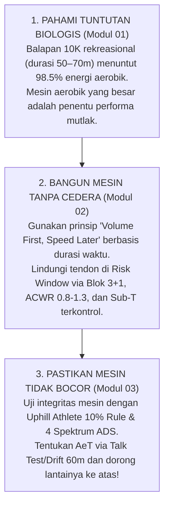

# Repositori Rujukan: Trilogi Fondasi Aerobik (*Aerobic Foundation Series*)

* **Penulis / Kurator Materi Asli**: **@ramadhanabs**
* **Landasan Teori**: Dr. Stephen Seiler (Polarized 80/20), Scott Johnston & Steve House (*Training for the Uphill Athlete*), John Holloszy & John "Hadd" Walsh.
* **Tujuan Repositori**: Panduan rujukan komprehensif fisiologi mesin aerobik, pencegahan cedera melalui periodisasi volume terukur, dan metode diagnosa kuantitatif defisiensi aerobik.
* **Fokus Atlet Terapan**: Pelari Jarak Jauh Rekreasional & Kompetitif (Contoh Target: 10K & Half Marathon).

---

## 1. Peta Navigasi Trilogi Modul

| Berkas Modul | Topik Utama | Intisari Sains & Formula Kunci | Integrasi Skill |
|---|---|---|:---:|
| [**01. Energy Systems: Build The Bigger Engine**](./01-energy-systems-build-the-bigger-engine.md) | Bioenergetika & Fisiologi Sel | • 30–32 vs 2 ATP efisiensi pembakaran glukosa (P/O ratio modern). • **97% (elit) s.d. 98.5% (rekreasional 55–65m) energi di 10K adalah aerobik**. • 70% serat lambat (Tipe I) + peran melatih serat hybrid (Tipe IIa). • Distribusi Seiler 80/20. | [`/lapor-lari`](../../.agents/skills/lapor-lari/SKILL.md) |
| [**02. Base Building: Volume First. Speed Later**](./02-base-building-volume-first-speed-later.md) | Periodisasi & Manajemen Beban Jaringan | • Menggeser kurva laktat (*The Bend*) ke 80% VO₂max. • *The Risk Window*: adaptasi jantung (6–12 mgg) vs tendon (3–10+ bln). • Pola Blok 3+1 (+10% ramp durasi waktu, -30% deload) & monitoring ACWR/CTL. • Penyelarasan NSA: Sub-T tetap jalan sepanjang tahun, yang ditunda adalah anaerobik all-out. | [`/jadwal-minggu`](../../.agents/skills/jadwal-minggu/SKILL.md) |
| [**03. Aerobic Deficiency Syndrome & The 10% Rule**](./03-aerobic-deficiency-syndrome-10-pct-rule.md) | Diagnosa Kuantitatif & Terapi Pemulihan | • 5 Sinyal bahaya ADS & distingsi drift tropis. • 3 Protokol penentuan AeT (Talk Test, Drift Test 60m, Proksi Hadd). • Spektrum 4 Tingkat ADS: Optimal ($\le 10\%$), Mild ($10.1\text{--}13\%$), Moderate ($13.1\text{--}18\%$), Severe ($>18\%$). • Metafora "Lantai Rusak" (*Broken Floor*). | [`/kalibrasi-atlet`](../../.agents/skills/kalibrasi-atlet/SKILL.md) [`diagnose_aerobic_base`](../../src/utils/hadd.ts) |

---

## 2. Benang Merah Sintesis Fisiologi

Ketiga materi ini membentuk satu rantai logika yang saling mengunci:

---

## 3. Matriks Aplikasi Praktis untuk Target 10K & Half Marathon

| Parameter Fisiologis Atlet | Formula / Kaidah | Pedoman Penerapan Berbasis Modul |
|---|:---:|---|
| **Kebutuhan Energi Lomba (10K)** | **98.5% Aerobik** | 98.5% fokus latihan harus diarahkan pada ekspansi kapasitas aerobik (Modul 01). |
| **Denyut Jantung Maksimum ($\text{HR}_{\max}$)** | **Baseline Terukur** | Patokan plafon mutlak lari santai (Easy Hadd): $\le \text{HR}_{\max} - 50\text{ bpm}$ (Modul 02). |
| **Ambang Anaerobik ($\text{AnT}$ / LTHR)** | **Ambang Laktat 2** | Plafon atap (*Ceiling*) ambang laktat 2 (Modul 03). |
| **Target Minimal $\text{AeT}$ (10% Rule)** | $\frac{\text{AnT} - \text{AeT}}{\text{AnT}} \le 10\%$ | Target celah aerobik ideal $\le 10\%$ dari AnT untuk performa endurance optimal. |
| **Derajat Toleransi Spektrum ADS** | **Level 1–2 Target** | Celah $\le 10\%$ = Beban penuh; Celah $10.1\text{--}13\%$ = Batasi Sub-T pada repetisi pendek Card A (3m) dan perbanyak Easy run. |
| **Manajemen Beban Impak** | **Durasi & Frekuensi** | Beban impak mekanis wajib dilindungi via volume berbasis durasi waktu, frekuensi teratur, dan penguatan tendon & rantai kinetik (Modul 02). |

---

## 4. Hubungan dengan Engine MCP di Repositori

Model komputasi repositori mengintegrasikan langsung konsep dari seri ini:
- **`src/utils/hadd.ts`**:
  * Mengintegrasikan formula Horwill (+10 s/km) bersama **Uphill Athlete 10% Rule** dalam fungsi `diagnoseAerobicBase`.
  * Memvalidasi apakah atlet terbebas dari ADS sebelum merekomendasikan penambahan volume Sub-Threshold.
- **`src/tools/intelligence.ts`**:
  * Tool `diagnose_aerobic_base` mengekspos diagnosa ganda ini ke seluruh antarmuka MCP.
- **`.agents/rules/norwegian-singles-guardrails.md`**:
  * Menetapkan aturan plafon $\le \text{HR}_{\max} - 50\text{ bpm}$ dan pengawasan celah $10\%$ sebagai guardrail keselamatan latihan harian.
