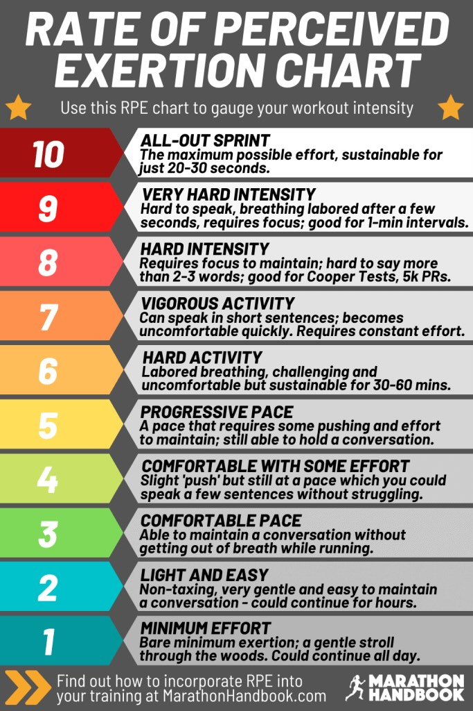

# 02 — Norwegian Approach Model, Sub-Threshold Copeland, dan Skala RPE

> **Sumber**: Threads Coach Faris Salman (@faris.salman)  
> **Tanggal Publikasi**: 13 April 2026  
> **Kategori**: Norwegian Singles Approach, Skala RPE, & Penjadwalan Strength Training

---

## 1. Teks Asli Threads (1/8 – 8/8)

### (1/8)
Selamat pagi.  
Lanjutin yg minggu lalu, *let's talk abt the Norwegian approach/model. It will get complicated. Pegangan.*  
Kl dr bukunya Bakken dan Copeland, menurutku, intinya Norwegian training model itu:  
- Intensitasnya itu *sub-maximal, terkontrol, precise*  
- *Repeatable exposure*  
- *Easy means Easy*  
Rekomendasi dr Bakken itu kl dibikin jd 3-Zone TID (*Training Intensity Distribution*) jd:  
- **70-80% Easy**  
- **20-30% Sub-Max**  
- **1-5% Hard**  
Kontrolnya via kombinasi *lactate/HR, pace, RPE*.

### (2/8)
Untuk tau dan bisa kendalikan intensitas butuh tau:  
a) 'Sensor'  
b) Kemampuan max saat ini  
Sbg manusia, kita punya 'sensor' subjektif. 'Sensor' ini bisa rasain sbrp besar effort yg dilakukan saat lari. Kl dikasih angka 1-10, ini jd **RPE**.  
Tp kl blm terlatih dlm RPE, perlu bantuan lain. Di sini peran external sensor spt lactate meter atau HRM. Norwegian model prefer lactate measurement, tp alatnya mahal dan repot. Cheaper alternative buat bantu latihan RPE adalah **external HRM**.

### (3/8)
Untuk ketahui kemampuan max saat ini perlu **test**.  
Dari test bisa ketauan kira2 harus lari di speed berapa atau intensitas seperti apa. Kl punya lactate meter, test dan pengukuran bisa sekalian. Kalo nggak, perlu field test. Krn asumsi ga pake lactate meter, mari bahas soal test dengan HRM.  
Tentunya ada bbrp test yg perlu dilakukan u/ establish bbrp instensitas penting:  
- **Talk Test / Extended Talk Test**: u/ establish VT1 (max easy pace/HR)  
- **5k test**: u/ predict LT2 pace  
- **LTHR test**: u/ predict LT HR

### (4/8)
Sayangnya, protokol u/ masing2 test ini beda2 jadi belum tentu bisa dilakukan sekaligus. Di level tertentu ada yg kebetulan overlap, tp belum tentu berlaku u/ semua orang.  
Jadi aku kasih reading resource u/ baca lebih lanjut ttg test di atas aja:  
- Talk Test dari High North Running  
- VDOT Calc u/ "Threshold" pace (vdoto2.com)  
- LTHR protocol & Zones dari High North Running

### (5/8)
Catatan tambahan, lari di "sub-maximal" effort itu berubah2 pace nya tergantung durasinya. Rekomendasi dari Bakken itu adalah **kurangin 5-25 detik/km dari "Threshold" pace yg diduga dari VDOT table**.  
Trus, kl pacenya beda2 gitu, eksekusinya gmn? kpn pacenya kencang, kpn pelan?  
Di sini masuk konsep ke **Norwegian Singles nya Copeland**.  
Copeland ngasih framework:  
- **'Fast'**: 3-4 min at **5-10 sec slower**  
- **'Medium'**: 4-6 min at **10-15 sec slower**  
- **'Long'**: 10-12 min at **15-25 sec slower**  
Semua dgn **60-90 easy recovery**.

### (6/8)
Sampe di sini kita udah punya:  
- Cara nentuin easy pace/HR  
- Cara nentuin pace buat repetisi sub-max effort  
- Cara nentuin LTHR  
Tinggal mikirin:  
- Seminggu mau lari berapa hari, total berapa jam.  
- **70-80% nya dibikin Easy**. Ini termasuk Long Easy Run.  
- **20-30% dari total lari seminggu dijadiin repetisi**. Mau 'fast', 'medium', 'long' atau kombinasi ketiganya, boleh. Tinggal dicoba, cari yang cocok dan pas jumlahnya.  
- **Jangan lupa Strides buat cukupin 1-5% dari total durasi**.

### (7/8)
Naikin % sub-maximalnya pelan2.  
Mulai di 20%, trus cek, badan berasa fresh apa nggak.  
Mungkin perlu 4-5 minggu u/ review. Jgn lupa test tiap 4-5 minggu. Badan manusia perlu sekitar 4-5 minggu u/ adaptasi thd stimulus.  
**Strength Training gimana?**  
Guideline dari Bakken begini:  
- **Lakukan ST di hari 'threshold'**  
- **Lakukan Explosive-focus ST di hari Strides**  
- **ST di hari2 tersebut, supaya Easy nya beneran u/ recovery**  
- Experiment, mana yg cocok. ST dulu baru lari, atau lari dulu baru ST. Bebas.

### (8/8)
Kesimpulannya, Norwegian method kl disederhanakan, sistemnya begini:  
- **Easy days**: recovery 40-60 menit  
- **Sub-maximal threshold-ish sessions**: buat quality days yang *repeatable*  
- **Strides 1-3x/minggu**: buat sentuhan speed  
- **Long run**: u/ durability dan volume  
- **Test**: u/ jaga supaya paces / effort ga ngawang dan tetap update dgn kondisi fisik  
U/ yg biasa latian HARD kayak interval sampe muntah, ga jarang Norwegian model bakal berasa 'kegampangan.' Ya gpp.  
*'Kegampangan' lebih enak drpd muntah2 kan?* 🙏🙏🙏  
*Fin.*

---

## 2. Rujukan Visual: Skala RPE (Rate of Perceived Exertion)

### Pemetaan Intensitas RPE ke dalam Model Latihan

| Level RPE | Kategori Exertion | Deskripsi Napas & Bicara | Penerapan di Norwegian Model |
| :---: | :--- | :--- | :--- |
| **1 – 2** | *Minimum Effort / Light & Easy* | Sangat santai, tidak membebani, bisa mengobrol berjam-jam tanpa lelah. | **Recovery Run** & Shakeout pasca sesi berat. |
| **3** | *Comfortable Pace* | Ritme nyaman, mengobrol lancar tanpa terengah-engah (*Talk Test VT1*). | **Easy Aerobic Run** harian & **Long Easy Run**. |
| **4** | *Comfortable with Some Effort* | Mulai ada dorongan ringan, masih bisa mengucapkan beberapa kalimat penuh. | Batas atas Easy Run / *Sub-AeT Zone*. |
| **5** | *Progressive Pace* | Membutuhkan fokus mempertahankan tempo; hanya bisa kalimat pendek. | Repetisi Sub-Threshold *Long Card* (10–12 menit). |
| **6** | *Hard Activity* | Napas ritmis berbobot, menantang namun stabil dipertahankan 30–60 menit. | Repetisi Sub-Threshold *Medium Card* (4–6 menit). |
| **7** | *Vigorous Activity* | Mulai tidak nyaman, hanya mampu mengucapkan frasa pendek 2–3 kata. | Repetisi Sub-Threshold *Fast Card* (3–4 menit). |
| **8** | *Hard Intensity* | Sangat berat, sulit bicara lebih dari 1–2 kata. | Sesi Uji Kalibrasi (*5K Time Trial* / Cooper Test). |
| **9** | *Very Hard Intensity* | Napas memburu dalam beberapa detik, butuh fokus total. | Akselerasi **Strides** (15–20 detik) / simulasi finish kick. |
| **10** | *All-Out Sprint* | Usaha maksimal mutlak, hanya bertahan 20–30 detik (*anaerobic burn*). | *Dilarang di Norwegian Base Building*. |

---

## 3. Matriks Copeland vs Contoh Baseline VDOT (Threshold 6:15 /km)

*Sub-Threshold* Copeland berada **5–25 detik LEBIH LAMBAT** dari Threshold Pace VDOT:

$$\text{Pace Sub-Threshold} = \text{Threshold Pace} + (5\text{ s/d }25\text{ s})$$

| Kategori Repetisi | Durasi Kerja | Formula Copeland | Target Pace Contoh (6:15 /km) | RPE Target | Recovery Jog |
| :--- | :---: | :---: | :---: | :---: | :---: |
| **Fast Repetitions** | 3 – 4 menit | $+5\text{ s/d }+10\text{ s}$ lebih lambat | **6:20 – 6:25 /km** | RPE 6–7 | 60–90 detik |
| **Medium Repetitions** | 4 – 6 menit | $+10\text{ s/d }+15\text{ s}$ lebih lambat | **6:25 – 6:30 /km** | RPE 5–6 | 60–90 detik |
| **Long Repetitions** | 10 – 12 menit | $+15\text{ s/d }+25\text{ s}$ lebih lambat | **6:30 – 6:40 /km** | RPE 5 | 60–90 detik |

---

## 4. Aturan Baku Strength Training (Marius Bakken)

> [!IMPORTANT]
> **Prinsip**: *"Keep Hard Days Hard, and Easy Days Easy!"*
> - Eksekusi **Strength Training (ST)** selalu dipasangkan pada **hari yang sama dengan sesi Quality / Sub-Threshold** atau hari **Strides**.
> - **Tujuan Fisiologis**: Menjaga agar hari *Easy* murni berfungsi untuk pemulihan seluler, perbaikan glikogen, dan regenerasi tendon, bebas dari stres mekanik beban angkat.
