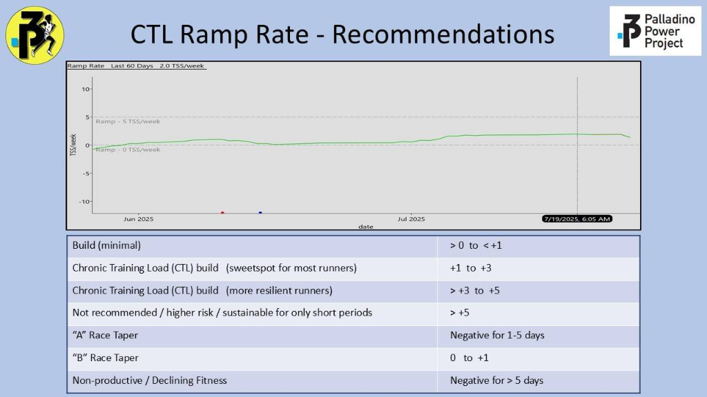
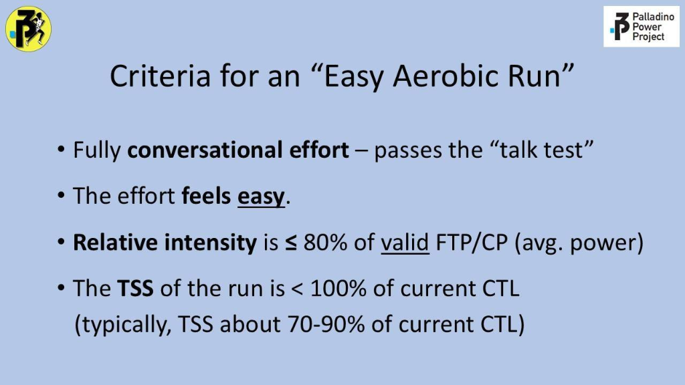
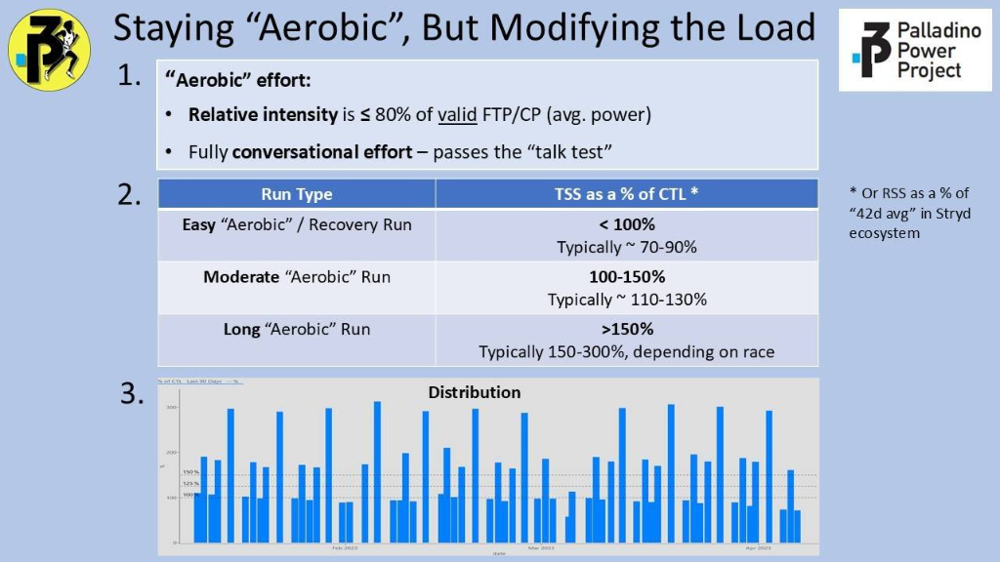
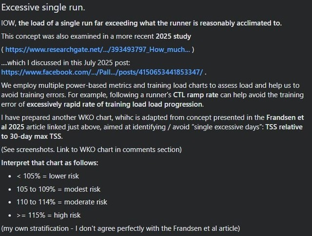
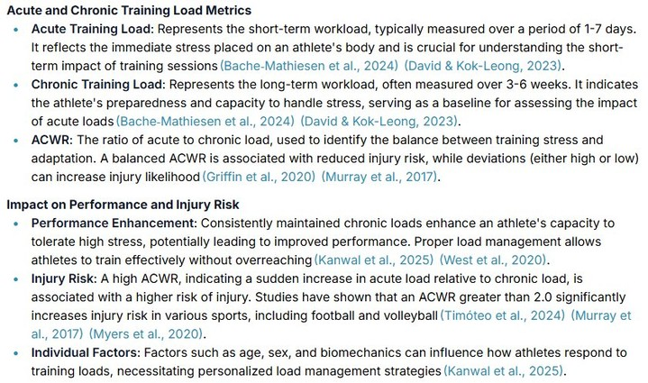

# 03 — Running Budgeting: Jarak, Beban Harian, dan Metrik Palladino

> **Sumber**: Threads Coach Faris Salman (@faris.salman)  
> **Tanggal Publikasi**: 20 April 2026  
> **Rujukan Ilmiah**: Steve Palladino (*Palladino Power Project*) & Frandsen et al. (2025)  
> **Kategori**: Load Management, Volume Budgeting, & Analisis Beban

---

## 1. Teks Asli Threads (1/6 – 6/6)

### (1/6)
Selamat Pagi...  
"Deep dive" hari ini ini ngomongin yg praktis2 aja.  
Cara hitung 'budget' jarak dan long run mingguan pake data harian.  
Makasih kmaren yg udah ikutan ngitung 42d avg km dan 90d LR.  
Sbnryna, ada website myTF run yg ngasih 'budget' mingguan.  
Tp km buat LR nya? km buat intervalnya? Blm ada.  
Trus kepikiran, apa guideline load-based applicable u/ distance-based?  
Maksudnya, pake guideline tsb u/ itung 'budget' easy, LR, interval, modal data mileage dari Strava.  
Mari 👇️

### (2/6)
"Rumus" ini bisa dipake buat menjawab pertanyaan:  
*'Minggu ini harusnya lari berapa km?'*  
Disclaimer, angka yg dihasilkan dari itung2an ini bkn target, tp semacam ancer2 berdasarkan jarak yg sudah dilarikan, setidaknya 42 hari terakhir. Kok 42 hari? Research suggested so.  
Rumus2 ini ga pake rumus aslinya, disimplifikasi spy gampang.  
Lanjut 👇️

### (3/6)
Pertama, **weekly budget**:  
Hitung rata2 km/minggu selama 42 hari terakhir. Kali 7. Ini baseline.  
Misal, rata2 42 hari ku 8km, maka baseline-ku di 56km.  
Nah, kl mau naik, pake profil risiko. Sesuaikan profil risiko dgn kemampuan recovery:  
🔵 `>-10%` → recovery/taper  
🔵 `-3% - -10%` → deload  
⚪ `0%` → maintenance  
🟢 `+3–8%` → **main aman**  
🟡 `+8–15%` → YAKIN bisa recovery  
🟠 `+15–25%` → risiko tinggi  
🔴 `+25%+` → risiko sangat tinggi  
Jd kl baseline-ku 56km, main aman aku bs tambah up to 60.5km.  
Lanjut 👇️

### (4/6)
Ke dua, **max long run "budget"**:  
Plafon long run ini dr dua konsep:  
1. **Palladino** (3x rata2 km 42 hari)  
2. **Frandsen et. al. 2025**  
Dr yg No. 1, dgn cth di atas, max LR ku di: $8 \times 3 = 24\text{ km}$.  
U/ No. 2, cari LR terjauh di 90 hari terakhir. Misal LR ku di 20km. Trus cocokin sama profil risiko:  
🟢 `~104%` → **main aman**  
🟡 `105–109%` → YAKIN bisa recovery  
🟠 `110–114%` → risiko tinggi  
🔴 `115%+` → risiko sgt tinggi  
Jd kl main aman, di 21km. Krn 21 < 24, ambil 21km. 21km ini TOTAL. Bisa LR tempo, LSD, dll.  
Lanjut 👇️

### (5/6)
Ke tiga, **u/ workout**:  
Plafon u/ workout ini pinjam dari Palladino (1,1 - 1,5x rata2 km 42 hari) trus ku ubah jadi profil risiko:  
🟢 `1,1–1,3x` → **aman**  
🟡 `1,3–1,5x` → YAKIN bisa recovery  
🟠 `1,50–2x` → risiko tinggi  
Misal dengan rata2 42 hari km 8km dan main 'aman', jadi sekitar: $8 \times 1.2 = 9.6\text{ km}$.  
Catatan: ini adalah **TOTAL sehari**. Intinya mencakup warmup, cooldown, short strides, interval, dan rest pas lagi sesi interval nya. Tentu, ini blm bahas ttg intensitas interval. Itu nanti lagi.  
Lanjut 👇️

### (6/6)
Ke empat, **Easy run dan Strides**:  
Dari itungan di atas kita punya budget:  
- Km mingguan: 56km  
- Km LR: 21km  
- Km Interval/Workout: 9.6km  
Kalo dikurangin, budgetnya tinggal 25,4km buat easy run. Ini tinggal dibagi rata ke sisa hari buat 'ngisi' budget mingguan. Misal mau tambah 4 hari easy, per hari rata2 6-6,5km. Misal mau 3 hari easy, per hari sekitar 8,4km rata2.  
Note:  
1. Itung2an ini itu sifatnya "budget". **Eksekusinya boleh kurang**.  
2. Untuk easy, dijaga intensitasnya. **Easy itu kata sifat. RPE 1-2**.

---

## 2. Rujukan Visual: Steve Palladino Power Project & Frandsen et al. (2025)

### A. Rekomendasi CTL Ramp Rate

*Intisari*:
- Progresi minimal: $>0\text{ s/d }<+1\text{ TSS/minggu}$.
- **Sweetspot Progresi Berkelanjutan**: **$+1\text{ s/d }+3\text{ TSS/minggu}$** (zona aman untuk mayoritas pelari).
- Atlet berpengalaman/tahan banting: $>+3\text{ s/d }+5\text{ TSS/minggu}$.
- Risiko cedera tinggi / unsustainable: $>+5\text{ TSS/minggu}$.

---

### B. Kriteria Resmi "Easy Aerobic Run"

*Standar Baku*:
1. Usaha berkonversasi penuh — **lolos uji bicara (*Talk Test*)**.
2. Usaha secara subjektif **terasa santai (*feels easy*, RPE 2–3)**.
3. Rata-rata daya (*relative intensity*) **$\le 80\%$ dari valid FTP/CP**.
4. Beban sesi (*TSS*) **$< 100\%$ dari CTL saat ini** (biasanya berada di kisaran $70\% - 90\%$ CTL).

---

### C. Klasifikasi Beban Lari Tunggal (*Single Run TSS as % of CTL*)

| Jenis Sesi Lari Aerobik | TSS sebagai % dari CTL | Rentang Tipikal |
| :--- | :---: | :---: |
| **Easy "Aerobic" / Recovery Run** | $< 100\%$ | $70\% - 90\%$ CTL |
| **Moderate "Aerobic" Run** | $100\% - 150\%$ | $110\% - 130\%$ CTL |
| **Long "Aerobic" Run** | $> 150\%$ | $150\% - 300\%$ CTL (bergantung target lomba) |

---

### D. Mencegah Lonjakan Hari Tunggal Berlebihan (*Excessive Single Run*)

*Kategori Risiko TSS / Jarak Lari Tunggal vs Rekor 30–90 Hari*:
- `< 105%` = **Risiko Rendah (*Lower Risk / Main Aman*)**
- `105% – 109%` = Risiko Moderat (*Modest Risk*)
- `110% – 114%` = Risiko Sedang (*Moderate Risk*)
- `≥ 115%` = **Risiko Tinggi (*High Risk / Excessive Day*)**

---

### E. Metrik Beban Akut & Kronis (ATL, CTL, ACWR)

- **Acute Training Load (ATL)**: Beban jangka pendek (1–7 hari). Menggambarkan stres kelelahan terkini.
- **Chronic Training Load (CTL)**: Beban jangka panjang (3–6 minggu / 42 hari). Menggambarkan kesiapan dan kapasitas tubuh menyerap beban.
- **ACWR (Acute:Chronic Workload Ratio)**: Rasio keseimbangan beban. ACWR di atas 1.5 meningkatkan risiko cedera, dan $\text{ACWR} > 2.0$ secara signifikan meningkatkan risiko cedera muskuloskeletal.
