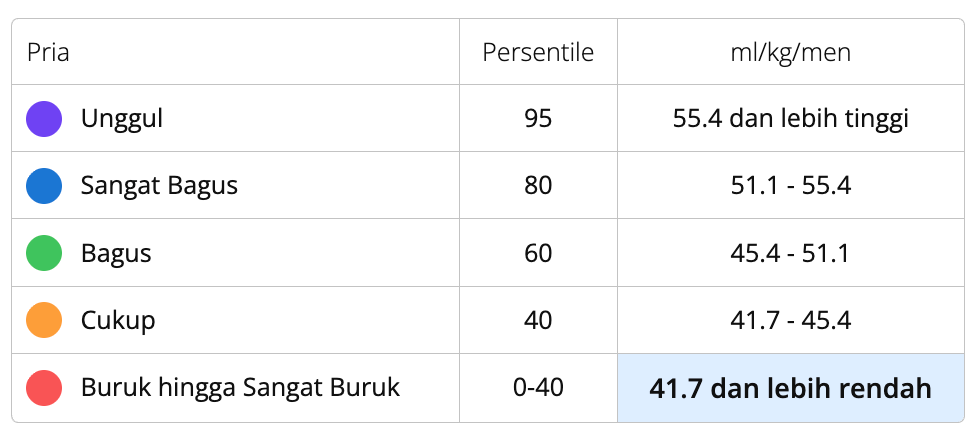

# Garmin VO₂ Maks & Endurance Running Reference

Dokumen ini berisi dokumentasi resmi Garmin terkait **VO₂ Maks**, tabel standar persentil pria dari *The Cooper Institute®*, analisis algoritma *Firstbeat Analytics*, serta interpretasi kepelatihan berbasis **Norwegian Singles Training Method** dan fisiologi olahraga untuk profil pelari rekreasional & kompetitif.

---

## 1. Dokumentasi Resmi Garmin: Apa itu VO₂ Maks?

> *Sumber: Garmin Connect / Garmin Device Knowledge Base & The Cooper Institute®, Dallas, Texas.*

VO₂ max adalah indikasi kebugaran kardiovaskular Anda dan akan meningkat seiring dengan peningkatan tingkat kebugaran Anda.

### Definisi
VO₂ max adalah volume maksimum oksigen (dalam mililiter) yang Anda konsumsi per menit per kilogram berat tubuh pada performa maksimum ($ml/kg/menit$). Perangkat Garmin yang kompatibel menggunakan data denyut jantung dan latihan untuk memperkirakan VO₂ max Anda.

### Variasi Multi-Sport
Nilai VO₂ max, VO₂ max bersepeda, dan VO₂ max mendayung mungkin berbeda karena otot yang digunakan dalam setiap aktivitas memiliki konsumsi oksigen yang berbeda. Tubuh Anda beradaptasi untuk mengonsumsi oksigen secara berbeda untuk tiap latihan dan konsumsi oksigennya mungkin lebih atau kurang optimal pada aktivitas tertentu.

### Pengaruh Suhu Panas & Ketinggian (Elevasi)
Panas dan ketinggian bisa memengaruhi pembacaan VO₂ max Anda. Hal yang wajar jika VO₂ max Anda sedikit menurun ketika Anda mulai latihan pada cuaca lebih panas atau di elevasi lebih tinggi. Perangkat Garmin tertentu akan menyesuaikan VO₂ max secara otomatis ketika Anda berlatih dalam cuaca panas, sehingga Anda mungkin tidak melihat penurunan signifikan seperti diperkirakan.

### VO₂ Maks & Status Latihan
Pembacaan VO₂ max dominan Anda digunakan untuk menentukan status latihan. Jika Anda lebih banyak bersepeda daripada berlari dalam beberapa hari terakhir, status latihan Anda akan dihitung menggunakan VO₂ max bersepeda.

### Cara Memperoleh Pembacaan
Untuk mendapatkan perkiraan VO₂ max, rekam aktivitas berjalan kaki, lari, atau bersepeda (sebaiknya di luar ruangan) atau dayung dalam ruangan dengan perangkat Garmin yang kompatibel. Aktivitas bersepeda dan mendayung harus direkam menggunakan pengukur daya (*power meter*).

---

## 2. Tabel Standar Persentil VO₂ Maks Pria (The Cooper Institute®)



| Kategori Klasifikasi | Persentil Populasi | Rentang Konsumsi Oksigen ($ml/kg/menit$) |
|---|:---:|:---:|
| 🟣 **Unggul (*Superior*)** | 95 | $\ge 55,4$ |
| 🔵 **Sangat Bagus (*Excellent*)** | 80 | $51,1 – 55,4$ |
| 🟢 **Bagus (*Good*)** | 60 | $45,4 – 51,1$ |
| 🟠 **Cukup (*Fair*)** | 40 | $41,7 – 45,4$ |
| 🔴 **Buruk hingga Sangat Buruk (*Poor*)** | 0 – 40 | $\le 41,7$ |

---

## 3. Analisis Mekanisme Algoritma Firstbeat Analytics

Algoritma Garmin/Firstbeat memperkirakan VO₂ Maks secara tidak langsung (*submaximal estimation*) menggunakan hubungan linier antara kecepatan lari (*Speed/Pace*) atau daya mekanik (*Power*) terhadap persentase denyut jantung cadangan ($\%HR_{\max}$):

$$\text{VO}_2\text{ Est} = f\left(\frac{\text{Kecepatan Langkah}}{\%HR_{\max}}\right) \times \frac{1}{\text{Massa Tubuh (kg)}}$$

### Faktor Koreksi Lapangan (Penyebab Deflasi Angka di Iklim Tropis):
1. **Stres Termal & Dehidrasi (*Thermal Cardiac Drift*)**:
   - Berlari pada suhu $26–31^\circ\text{C}$ dengan kelembapan relatif $75–85\%$ (iklim tropis hangat) memicu vasodilatasi pembuluh darah kulit untuk pembuangan panas.
   - Hal ini menaikkan denyut jantung sebesar **12–24 bpm** lebih tinggi untuk laju lari yang sama (*cardiac drift*). Algoritma jam tangan membaca lonjakan HR ini sebagai "efisiensi oksigen yang rendah", sehingga angka estimasi VO₂ maks tertekan turun secara artifisial.
2. **Variabel Pembagi Berat Badan**:
   - Karena satuan yang digunakan adalah per kilogram berat tubuh ($/kg$), setiap kilogram massa tubuh non-esensial menurunkan angka relatif ini secara matematis, meskipun kapasitas absolut paru-paru dan jantung pelari sangat besar.
3. **Ketiadaan Sesi *All-Out* VO₂max**:
   - Metode lari *Sub-Threshold* sengaja menghindari lari sprint Zona 5/6 yang melelahkan. Algoritma Garmin jarang mendapatkan sampel data saat atlet berada di kapasitas puncak, sehingga model mengasumsikan kurva estimasi yang lebih konservatif.

---

## 4. Perspektif Norwegian Singles: Segitiga Kinerja Ketahanan

Dalam filosofi **Norwegian Singles Training Method** dan sains ketahanan modern (Dr. Marius Bakken, Steve Magness), performa lari jarak jauh (khususnya Half Marathon) ditentukan oleh **tiga pilar fisiologis**, di mana VO₂ Maks hanyalah salah satu komponennya:

```
                       ▲
                      / \
                     /   \
                    / VO₂ \
                   /  Maks \  <── Plafon Potensi Mesin Aerobik
                  /─────────\
                 / Fractional\
                / Utilization \ <── Persentase Kapasitas yang Bisa Dipakai di Ambang (LT2)
               /───────────────\
              / Running Economy \ <── Kehematan Penggunaan Oksigen per Langkah
             /───────────────────\
```

### 1. VO₂ Maks (Ukuran Plafon / Kapasitas Mesin)
Menunjukkan batas kapasitas kardiorespirasi maksimal. Pada perlombaan Half Marathon (21,1 km), seorang pelari **tidak pernah** berlari pada 100% VO₂ Maks karena asidosis laktat akan menghentikan lari dalam 6–10 menit.

### 2. Pemanfaatan Fraksional (*Fractional Utilization of VO₂ Max*)
Menunjukkan berapa persen dari VO₂ Maks yang mampu dipertahankan atlet di ambang batas laktat kedua (*Lactate Threshold 2 / LT2*) tanpa kelelahan dini:
- Pelari rekreasional umum: Hanya mampu memanfaatkan **65–75%** VO₂ Maks.
- Pelari berbasis Norwegian Singles: Mampu mempertahankan **85–92%** dari kapasitas aerobiknya stabil selama lebih dari 2 jam melalui stimulasi berulang sesi *Sub-Threshold* (Card A, Card B, Card C).

### 3. Efisiensi Gerak (*Running Economy*)
Banyaknya oksigen ($ml\text{ O}_2/kg/km$) yang dibutuhkan untuk bergerak pada kecepatan tertentu. Faktor yang meningkatkan efisiensi gerak meliputi:
- Kadens langkah tinggi ($\ge 175$ spm) untuk mengurangi gaya pengereman (*braking force*).
- Sepatu lari berpelat (*carbon/nylon plate*).
- Kekuatan otot inti dan stabilisator panggul (*McGill Big 3*).

---

## 5. Kalibrasi Data Lapangan vs Estimasi Smartwatch

- **Estimasi Sensor Jam**: Sering kali tertekan lebih rendah di iklim tropis dan lembap akibat faktor suhu dan pembagi massa tubuh.
- **VDOT Terkalibrasi (Jack Daniels Running Formula)**: Dihitung secara objektif dari hasil time trial lapangan atau perlombaan resmi terkini via `calculate_vdot`.
- **Critical Power (CP / FTP Lari)**: Menjadi panduan intensitas primer yang stabil tanpa distorsi denyut jantung akibat cuaca panas.

### Rekomendasi Kepelatihan:
1. Perlakukan angka VO₂ Maks Garmin sebagai **indikator tren jangka panjang**, bukan vonis mutlak performa hari lomba.
2. Fokus utama latihan tetap pada disiplin daya mekanik (Watt), kepatuhan *Sub-Threshold*, dan kesegaran fisik (*TSB Positive*) menjelang hari perlombaan.
