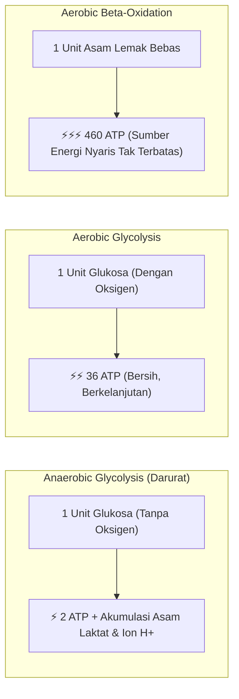

# Dinamika Ambang Laktat & Ekonomi Bahan Bakar (Hadd Part II)

* **Sumber Dokumen**: *Hadd's Approach to Distance Training* (Part II: *The Real Limit & Fuel Economics*)
* **Narasumber**: John "Hadd" Walsh (Pelatih atlet jarak jauh & kontributor legendaris LetsRun)
* **Dokumen Rujukan**: [`docs/references/Hadd’s Approach to Distance Training.pdf`](./Hadd’s%20Approach%20to%20Distance%20Training.pdf)
* **Status Validasi**: Fondasi biokimia dan bioenergetika untuk kontrol ambang laktat dan disiplin intensitas Easy Run.

---

## 1. Batas Sebenarnya Bukan Jantung, Melainkan Otot Kaki

Banyak pelari berasumsi bahwa kapasitas paru-paru dan ukuran jantung ($\text{VO}_2\text{max}$) adalah faktor pembatas utama lari jarak jauh. Hadd menjelaskan bahwa jantung dan paru-paru dapat memompa oksigen dalam jumlah melimpah, tetapi jika **serat otot kaki (*peripheral musculature*)** tidak memiliki cukup mitokondria, kapiler darah, dan enzim aerobik untuk memproses oksigen tersebut, maka oksigen yang dipompa akan sia-sia.

> *"If we find that our runner has little or no evidence of a relationship between his/her race performances... we can be very sure the problem is in his legs."* — Hadd

---

## 2. Landasan Sains: Korelasi Ambang Laktat dan Performa

Penelitian ilmiah endurance terkemuka mengonfirmasi prinsip ini:
1. **Costill et al. (1973)**:
   - Pelari jarak jauh berprestasi tinggi mampu menggunakan persentase $\text{VO}_2\text{max}$ yang lebih tinggi dengan akumulasi laktat darah yang jauh lebih rendah.
2. **Sjödin & Svedenhag (1985)**:
   - Ambang laktat (*Lactate Threshold*) adalah **prediktor tunggal terbaik** (*the best single predictor*) untuk performa lari jarak jauh, jauh lebih akurat dibanding angka $\text{VO}_2\text{max}$ laboratorium mentah.
3. **Pemanfaatan Kapasitas Aerobik pada Marathon**:
   - Pelari yang terlatih dengan baik mampu mempertahankan **$85\%+$ dari $\text{VO}_2\text{max}$** mereka sepanjang maraton karena tubuh mereka memproduksi laktat lebih sedikit di setiap kecepatan lari.

---

## 3. Neraca Energi & Ekonomi Bahan Bakar: 460 vs 36 vs 2 ATP

Tubuh pelari memiliki dua sumber bahan bakar utama: **Lemak** dan **Karbohidrat (Glukosa/Glikogen)**.

### Nilai Energi per 1 Unit Bahan Bakar:
| Sumber Bahan Bakar | Jalur Metabolisme | Energi yang Dihasilkan | Ketersediaan di Tubuh |
|---|---|:---:|---|
| **Glukosa** | Anaerobik (Glikolisis cepat) | **2 ATP** | Sangat boros, habis dalam hitungan menit |
| **Glukosa** | Aerobik (Siklus Krebs + Rantai Transpor Elektron) | **36 ATP** | Terbatas (cadangan glikogen hati & otot $\sim 2000\text{ kcal}$) |
| **Asam Lemak** | Aerobik ($\beta$-Oksidasi) | **460 ATP** | Nyaris tak terbatas ($> 50.000\text{--}80.000\text{ kcal}$) |

### Mengapa Pelari Mengalami "Hit the Wall" atau "Fading"?
Ketika ambang laktat pelari rendah:
1. Serat otot tidak mampu membakar asam lemak secara efisien pada kecepatan lomba yang diinginkan.
2. Akibatnya, tubuh terpaksa **"meminjam" jalur anaerobik** (*borrowing anaerobic energy*).
3. Karena 1 glukosa anaerob hanya menghasilkan **2 ATP** (dibandingkan 36 ATP aerobik), laju pembakaran glikogen menjadi **18x lebih boros**!
4. Begitu cadangan glikogen habis total di km 15–30, pelari mengalami perlambatan dramatis (*bonking / fading*) karena dipaksa berjalan pada kecepatan minimum pembakaran lemak sisa.

---

## 4. Dua Penyebab Utama Rendahnya Ambang Laktat

Hadd merumuskan dua kesalahan fatal yang paling sering dilakukan pelari jarak jauh:

### Penyebab 1: Kilometer Mingguan Kurang (*Not Enough Weekly Kilometres*)
- Mitokondria adalah organel sel tempat terjadinya pembakaran lemak dan glukosa aerobik.
- Perkembangan volume dan kepadatan mitokondria berbanding lurus dengan total waktu dan kilometer yang dihabiskan untuk berlari. Pelari yang hanya berlari 30–40 km/pekan tidak memiliki kepadatan mitokondria yang cukup untuk mendukung lomba jarak Half Marathon atau Marathon.

### Penyebab 2: Lari Santai Terlalu Kencang (*Easy Runs Run Too Fast*)
- Banyak pelari merasa "malu" atau merasa "tidak berolahraga" jika berlari santai pada pace 7:30–8:30 /km. Mereka memaksakan pace 5:30–6:00 /km di setiap sesi lari harian mereka.
- Akibatnya:
  * Detak jantung melonjak ke zona abu-abu (*medium-effort grey zone*).
  * Pembakaran lemak ditekan, glikogen terbuang percuma setiap hari.
  * Serat otot lambat (*slow-twitch*) tidak mendapatkan adaptasi enzimatik spesifik yang dibutuhkannya.
  * Tubuh mengalami kelelahan kronis yang merusak kualitas sesi lari kunci berikutnya.
