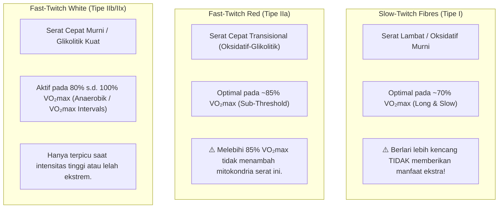

# Biogenesis Mitokondria & Spesifisitas Serat Otot (Hadd Part III)

* **Sumber Dokumen**: *Hadd's Approach to Distance Training* (Part III: *Mitochondria & Muscle Fibre Types*)
* **Narasumber**: John "Hadd" Walsh (Pelatih atlet jarak jauh & kontributor legendaris LetsRun)
* **Dokumen Rujukan**: [`docs/references/Hadd’s Approach to Distance Training.pdf`](./Hadd’s%20Approach%20to%20Distance%20Training.pdf)
* **Status Validasi**: Landasan sitologi dan fisiologi seluler untuk distribusi volume lari lambat (*Easy Volume*) vs Sub-Threshold.

---

## 1. Hubungan Durasi Lari Harian dengan Kepadatan Mitokondria

Penelitian terobosan oleh Dr. John Holloszy (bapak biokimia latihan olahraga modern) dan riset lanjutan oleh **Dudley et al. (1982)** membuktikan bahwa adaptasi enzim mitokondria (*succinate dehydrogenase / SDH* dan *citrate synthase*) di otot rangka berkorelasi sangat kuat dengan **total durasi lari harian pada intensitas aerobik sedang**:

### Uji Daya Tahan Berdasarkan Waktu Latihan Harian (pada 50–60% VO₂max):

| Durasi Lari Harian | Indeks Daya Tahan / Waktu Bertahan (*Endurance Test*) | Peningkatan Relatif |
|---|:---:|:---:|
| **10 menit / hari** | 22 menit | Basis |
| **30 menit / hari** | 41 menit | $+86\%$ |
| **60 menit / hari** | 50 menit | $+127\%$ |
| **120 menit (2 jam) / hari** | **111 menit** | **$+404\%$ (Lompatan Eksponensial)** |

> [!NOTE]
> Menambah durasi lari dari 60 menit menjadi 120 menit meningkatkan kapasitas daya tahan lebih dari dua kali lipat ($50 \rightarrow 111\text{ menit}$). Ini membuktikan bahwa pembentukan mitokondria membutuhkan **akumulasi waktu di bawah beban kerja aerobik** (*time on feet*).

---

## 2. Kebutuhan Stimulus Optimal Berdasarkan Tipe Serat Otot (Dudley, 1982)

Otot manusia tersusun atas berbagai jenis serat otot yang bekerja secara bertahap (*Henneman's Size Principle*). Setiap tipe serat membutuhkan intensitas spesifik untuk memicu biogenesis mitokondria:

### Rincian Respon Serat Otot:

1. **Slow-Twitch (Tipe I)**:
   - **Karakteristik**: Sangat tahan lelah, kaya mioglobin dan kapiler, mesin pembakar lemak utama.
   - **Stimulus Terbaik**: Lari panjang dan santai pada **$\sim 70\%$ $\text{VO}_2\text{max}$** (setara dengan $\le 70\text{--}74\%$ $\text{HR}_{\max}$).
   - **Aturan Emas**: *"Faster is NOT better."* Menambah kecepatan saat melatih serat lambat tidak meningkatkan mitokondria serat tersebut, melainkan hanya memindahkan beban ke serat cepat dan memicu produksi laktat dini.
2. **Fast-Twitch Red (Tipe IIa)**:
   - **Karakteristik**: Serat cepat yang memiliki kapasitas aerobik jika dilatih dengan benar. Kunci keberhasilan pelari 10K hingga Marathon!
   - **Stimulus Terbaik**: Mencapai puncak biogenesis mitokondria pada **$\sim 85\%$ $\text{VO}_2\text{max}$** (setara zona *Sub-Threshold* / LT1–LT2).
   - **Aturan Emas**: *"No gain from going faster."* Berlari di atas ambang laktat (misal $95\text{--}100\%$ $\text{VO}_2\text{max}$) tidak memberikan pertambahan mitokondria tambahan pada serat IIa, melainkan hanya menumpuk asidosis dan kelelahan saraf.
3. **Fast-Twitch White (Tipe IIb/IIx)**:
   - **Karakteristik**: Menghasilkan daya ledak besar tetapi cepat lelah.
   - **Stimulus Terbaik**: Dimulai dari $80\%$ dan meningkat hingga $100\%$ $\text{VO}_2\text{max}$.

---

## 3. Bahaya "Hard-Only Training" (Pelajaran Pribadi Hadd)

Banyak pelari yang hanya melakukan lari cepat (interval 400m, fartlek keras, lari tempo gaspol) berasumsi bahwa lari cepat otomatis mencakup seluruh adaptasi lari lambat. **Hadd membuktikan bahwa asumsi ini salah besar.**

### Kasus Nyata yang Dialami Hadd Sendiri:
- Setelah 3 bulan hanya melakukan latihan keras (*hard-only training*), Hadd mendapati dirinya mampu berlari $5\times 1000\text{ m}$ kencang di lintasan.
- Namun, ketika mencoba lari santai $2\text{ jam}$, ia **sangat menderita dan kehabisan tenaga bahkan pada pace lambat 4:58 /km**!
- **Penyebab Biologis**: Latihan serba keras secara konsisten "melompati" (*skipped*) adaptasi enzimatik pada serat otot *slow-twitch*. Akibatnya, serat lambatnya tidak memiliki ketahanan glikogen dan kapasitas oksidasi lemak untuk mempertahankan lari jarak jauh.

---

## 4. Relevansi dengan Prinsip Norwegian Singles & Aturan 75/25

Konsep Dudley dan Hadd ini adalah dasar ilmiah mutlak di balik:
1. **Aturan Durasi 75/25 NSA**:  
   $75\text{--}80\%$ waktu latihan mingguan dialokasikan untuk lari *Easy Aerobic* murni ($\sim 70\%$ $\text{VO}_2\text{max}$) untuk memaksimalkan adaptasi mitokondria serat lambat tanpa kelelahan.
2. **Sesi Sub-Threshold Terkontrol (20–25%)**:  
   Dibatasi pada rentang $\sim 85\%$ $\text{VO}_2\text{max}$ (85–96% CP / < 172 bpm) untuk memaksimalkan adaptasi mitokondria serat *Fast-Twitch Red (IIa)* tanpa melompati batas menjadi anaerobik.
