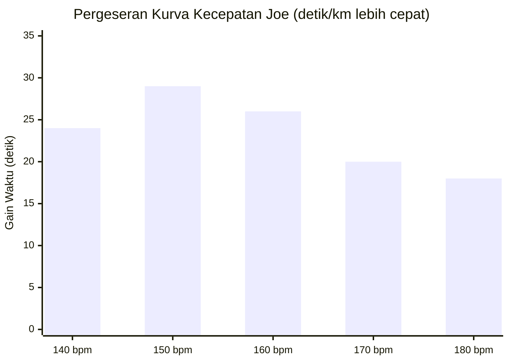

# Protokol Tes Bertingkat 2400m & Studi Kasus "Joe" (Hadd Part IV & V "A")

* **Sumber Dokumen**: *Hadd's Approach to Distance Training* (Part IV: *The Testing Protocol* & Part V "A": *The Case of Joe*)
* **Narasumber**: John "Hadd" Walsh (Pelatih atlet jarak jauh & kontributor legendaris LetsRun)
* **Dokumen Rujukan**: [`docs/references/Hadd’s Approach to Distance Training.pdf`](./Hadd’s%20Approach%20to%20Distance%20Training.pdf)
* **Status Validasi**: Protokol kalibrasi lapangan objektif untuk mengukur pergeseran kurva laktat dan efisiensi kardiovaskular.

---

## 1. Protokol Hadd 2400m Step Test (Tes Bertingkat Detak Jantung)

Untuk mengetahui profil laktat dan kecepatan seorang pelari tanpa memerlukan laboratorium medis yang mahal, Hadd merancang **Tes Bertingkat 2400 meter** (*Hadd 2400m Heart Rate Step Test*) di lintasan lari standar 400 meter:

### Prosedur Pelaksanaan:
1. **Format**: $5 \times 2400\text{ meter}$ (masing-masing 6 putaran lintasan).
2. **Kontrol Detak Jantung**: Setiap repetisi dikunci pada zona denyut jantung tertentu yang berjarak $10\text{ bpm}$ (contoh standar untuk $\text{HR}_{\max} \sim 190\text{--}195\text{ bpm}$: **140, 150, 160, 170, dan 180 bpm**).
   - Atlet berlari dengan tali monitor detak jantung dada (*chest strap*).
   - 400 meter pertama digunakan untuk menaikkan denyut jantung ke angka target, lalu 2000 meter berikutnya dipertahankan konstan di angka tersebut.
3. **Jeda Istirahat**: Tepat **90 detik** berjalan kaki santai atau jogging pelan antar-repetisi.
4. **Data yang Dicatat**: Waktu tempuh total per 2400m dan rata-rata pace per kilometer di setiap level denyut jantung.

---

## 2. Studi Kasus Legendaris: "Joe"

### Profil Awal Joe:
* **Usia**: $\sim 35\text{ tahun}$.
* **Kondisi Fisik**: Kelebihan berat badan $\sim 9\text{ kg}$, volume latihan hanya $\sim 32\text{ km/pekan}$.
* **Latar Belakang**: Mantan pelari maraton elit (PB maraton masa muda 2:27), namun saat datang ke Hadd sistem aerobiknya telah rusak akibat lama tidak berlatih konsisten.

### Rekam Jejak Kemajuan Joe dalam 12 Pekan (Hadd 2400m Test):

| Denyut Jantung Target | 11 Mei (Tes 1) | 6 Juni (Tes 2) | 29 Juni (Tes 3) | 4 Agustus (Tes 4) | Total Efisiensi (*Pace Gain*) |
|:---:|:---:|:---:|:---:|:---:|:---:|
| **140 bpm** | 4:56 /km | 5:00 /km | 4:35 /km | **4:32 /km** | **$-24\text{ detik/km}$** |
| **150 bpm** | 4:35 /km | 4:32 /km | 4:14 /km | **4:06 /km** | **$-29\text{ detik/km}$** |
| **160 bpm** | 4:10 /km | 4:06 /km | 3:51 /km | **3:44 /km** | **$-26\text{ detik/km}$** |
| **170 bpm** | 3:47 /km | 3:44 /km | 3:33 /km | **3:27 /km** | **$-20\text{ detik/km}$** |
| **180 bpm** | 3:31 /km | 3:27 /km | 3:18 /km | **3:13 /km** | **$-18\text{ detik/km}$** |

---

## 3. Hasil Akhir & Analisis Keberhasilan Joe

Dalam kurun waktu **20 pekan** sejak hari pertama program:
1. **Finish Half Marathon: 71 Menit 43 Detik (1:11:43)**:  
   Pace rata-rata lomba adalah **3:24 /km**!
2. **Progresi Volume Mingguan**:  
   Meningkat bertahap dari $103\text{ km/pekan}$ hingga puncaknya $187\text{ km/pekan}$ di pekan ke-16.
3. **Fakta Paling Mengejutkan**:  
   **NOL (0) sesi interval VO₂max atau lari tempo keras!**  
   Joe tidak pernah melakukan interval $400\text{ m}$, tidak pernah melakukan latihan asam laktat yang menyiksa. Seluruh latihan dilakukan di bawah ambang laktat dengan memantau denyut jantung secara ketat.

---

## 4. Pelajaran Fisiologis: Pergeseran Kurva Laktat ke Kanan (*Rightward Shift*)

1. **Kurva Menjadi Datar & Bergeser ke Kanan**:
   - Pada awal Mei, pada denyut 170 bpm laktat Joe sudah mulai menumpuk dan ia hanya mampu berlari 3:47 /km.
   - Pada bulan Agustus, pada denyut 170 bpm tubuhnya membakar lemak dengan sangat efisien sehingga ia mampu berlari 3:27 /km tanpa akumulasi asam laktat berlebih.
2. **Efek Multiplier pada Kecepatan Lomba**:
   - Ketika kapasitas aerobik pada 140–160 bpm meningkat drastis, kecepatan pada 170–180 bpm **secara otomatis ikut terangkat naik** tanpa perlu dilatih dengan kecepatan tinggi terus-menerus.
   - Inilah bukti empiris bahwa membangun fondasi aerobik lambat secara fundamental menaikkan batas atas seluruh spektrum performa lari.
