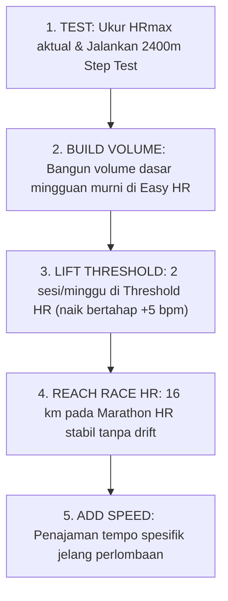

# Zona Latihan Denyut Jantung & Periodisasi "Pasta Gigi" (Hadd Part V "B" & VI)

* **Sumber Dokumen**: *Hadd's Approach to Distance Training* (Part V "B": *Periodization & Training Zones* & Part VI: *The Full Picture*)
* **Narasumber**: John "Hadd" Walsh (Pelatih atlet jarak jauh & kontributor legendaris LetsRun)
* **Dokumen Rujukan**: [`docs/references/Hadd’s Approach to Distance Training.pdf`](./Hadd’s%20Approach%20to%20Distance%20Training.pdf)
* **Status Validasi**: Formula matematis pemetaan zona denyut jantung dan aturan progresi bertahap beban latihan.

---

## 1. Rumus Zona Latihan Berbasis $\text{HR}_{\max}$ Riil

Hadd menolak penggunaan rumus perkiraan usia (seperti $220 - \text{usia}$) karena deviasi standarnya terlalu lebar. Atlet **wajib mengukur denyut jantung maksimum aktual** di lapangan (misal via tes $800\text{ m} + 400\text{ m}$ all-out).

Setelah $\text{HR}_{\max}$ terukur, zona latihan dipetakan sebagai berikut:

$$\text{Easy Running} \le \text{HR}_{\max} - 50\text{ bpm}$$
$$\text{Start Threshold} \approx \text{HR}_{\max} - 35\text{ bpm}$$
$$\text{Marathon Race HR} \approx \text{HR}_{\max} - 25\text{ s.d. } 30\text{ bpm}$$

### Matriks Zona Latihan Hadd:

| $\text{HR}_{\max}$ Atlet | Easy Running (Maksimal) | Start Threshold Range | Target Marathon HR |
|:---:|:---:|:---:|:---:|
| **$\ge 193+$ bpm** | $\le 145\text{ bpm}$ | **155 – 160 bpm** | 175 – 177 bpm |
| **183 bpm** | $\le 135\text{ bpm}$ | **145 – 150 bpm** | 165 – 167 bpm |
| **173 bpm** | $\le 125\text{ bpm}$ | **135 – 140 bpm** | 155 – 157 bpm |
| **163 bpm** | $\le 115\text{ bpm}$ | **125 – 130 bpm** | 145 – 147 bpm |

> [!NOTE]
> Untuk atlet dengan $\text{HR}_{\max} = 207\text{ bpm}$ (seperti pada contoh pelari terkalibrasi):
> - **Easy Running**: $207 - 50 = \mathbf{\le 157\text{ bpm}}$ (persis dengan batas aman iklim tropis $\le 155\text{ bpm}$).
> - **Start Threshold**: $207 - 35 = \mathbf{\sim 172\text{ bpm}}$ (persis dengan batas rem laktat Sub-T Ceiling $< 168\text{--}172\text{ bpm}$).
> - **Marathon/HM HR**: $207 - 25 = \mathbf{\sim 180\text{--}182\text{ bpm}}$ (mendekati LTHR $188\text{ bpm}$).

---

## 2. Tiga Aturan Operasional Hadd (*The Three Rules*)

1. **Aturan Progresi (*The Progress Rule*)**:
   - Naikkan intensitas threshold denyut jantung sebesar $+5\text{ bpm}$ **HANYA JIKA** atlet mampu menuntaskan lari sejauh **$16\text{ km}$** (atau $\sim 10\text{ mil}$) pada denyut tersebut dengan pace yang stabil dan **tanpa pergeseran denyut jantung (*no cardiac drift*)**.
   - Dilarang menaikkan target detak jika di akhir sesi denyut jantung melonjak atau kecepatan melorot.
2. **Aturan Pengujian (*The Test Rule*)**:
   - Ulangi tes bertingkat $2400\text{ m}$ ($140 \rightarrow 180\text{ bpm}$) setiap **$\sim 6\text{ pekan}$** pada kondisi lingkungan, jam, dan lintasan yang setara untuk memverifikasi pergeseran kurva efisiensi.
3. **Aturan Kesiapan Lomba (*The Ready Rule*)**:
   - Seorang pelari dinyatakan benar-benar siap berlomba maraton/HM ketika sesi lari **$16+\text{ km}$ pada Marathon HR** terasa stabil, nyaman, dan dapat diulang tanpa menimbulkan kelelahan ekstrem berhari-hari.

---

## 3. Roadmap 5 Tahap Menuju Puncak Performa

Periodisasi Hadd tidak menggunakan siklus blok linier 4-mingguan yang rumit, melainkan 5 fase berurutan yang berbasis pencapaian kompetensi biologis:

| Fase | Tahap Pelaksanaan | Fokus Utama Latihan |
|:---:|---|---|
| **1** | **Testing** | Menemukan $\text{HR}_{\max}$ riil dan baseline kurva $2400\text{ m}$. |
| **2** | **Build Volume** | Meningkatkan volume mingguan hingga kapasitas optimal, hampir seluruhnya di zona Easy. |
| **3** | **Lift Threshold** | Menjadwalkan **2 sesi per pekan** pada Threshold HR; menaikkan $5\text{ bpm}$ secara bertahap saat adaptasi tercapai. |
| **4** | **Reach Race HR** | Mengunci sesi lari spesifik $16\text{ km}$ pada target detak jantung lomba maraton tanpa *cardiac drift*. |
| **5** | **Add Speed** | Memasukkan latihan tempo spesifik: $16\text{ km} @ \text{MP} + 3\text{--}6\text{ s}$ dan $6\text{--}8\text{ km} @ \text{MP} - 7\text{ s}$. |

* **Estimasi Waktu**: Pembangunan fondasi pertama membutuhkan $\sim 20\text{ pekan}$. Untuk siklus berikutnya, cukup $10\text{--}12\text{ pekan}$ jika kapasitas aerobik dasar tetap terjaga.

---

## 4. Filosofi Pasta Gigi (*The Toothpaste Tube Analogy*)

Metafora paling terkenal dari Hadd adalah analogi tabung pasta gigi:

> *"Like toothpaste: start at the end of the tube and squeeze slowly up."*

- Jika Anda membeli pasta gigi baru dan langsung memencetnya di dekat tutup tabung (bagian atas), pasta gigi akan keluar sedikit dengan cepat, tetapi bagian bawah tabung akan menggembung dan sisa isinya menjadi berantakan serta sulit dikeluarkan.
- Pelari yang langsung berlatih interval cepat di awal musim diibaratkan memencet pasta gigi di dekat tutup: performanya naik kilat dalam 3–4 pekan, tetapi kemudian **stagnan, rentan cedera, dan anjlok** di lomba jarak jauh.
- Sebaliknya, mulailah memeras tabung pasta gigi dari **ujung paling belakang (zona aerobik rendah & sedang)**, lalu dorong perlahan ke atas. Dengan cara ini, Anda memeras seluruh tetes potensi fisiologis tubuh hingga ke garis akhir lomba!
