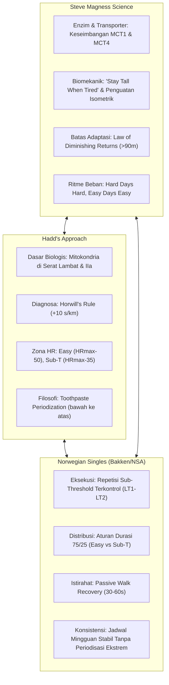

# Hadd's Approach to Distance Training — Reference Library

Koleksi dokumentasi ilmiah dan panduan komprehensif hasil telaah naskah legendaris **John "Hadd" Walsh** (*Hadd's Approach to Distance Training*, Parts I–VI) dan 8 infografis eksekutif yang merangkum metodologi ini.

Dokumen ini melengkapi pustaka ilmiah di dalam folder `docs/references/` sebagai **fondasi pemahaman biogenesis mitokondria, efisiensi substrat bahan bakar, dan pemetaan kurva laktat berbasis denyut jantung**.

---

## 📚 Daftar Modul Referensi Lengkap

| No | Berkas Dokumen | Topik Pembahasan Utama | Relevansi & Skill Terkait |
|:---:|---|---|---|
| **1** | [`01-aerobic-deficiency-and-horwill-rule.md`](./01-aerobic-deficiency-and-horwill-rule.md) | **Diagnosa Basis Aerobik & Frank Horwill's Rule** Aturan perlambatan $+10\text{ s/km}$ per doubling distance dan deteksi pelari defisien aerobik. | `/predict-race`, `race-strategy`, `running-coach-analysis` |
| **2** | [`02-lactate-dynamics-and-fuel-economics.md`](./02-lactate-dynamics-and-fuel-economics.md) | **Dinamika Ambang Laktat & Ekonomi Bahan Bakar** Peran otot perifer di kaki, perbandingan energi ATP (Lemak 460 vs Glukosa 36 vs Anaerob 2), dan bahaya *easy run* terlalu kencang. | `/run-report`, `readiness-check`, `norwegian-singles-guardrails` |
| **3** | [`03-mitochondrial-biogenesis-by-fibre-type.md`](./03-mitochondrial-biogenesis-by-fibre-type.md) | **Biogenesis Mitokondria & Spesifisitas Serat Otot** Riset Dudley (1982) & Holloszy: Mengapa serat lambat butuh durasi panjang @ 70% VO₂max dan serat cepat butuh 85% VO₂max. | `weekly-budget`, `plan-week`, `training-load-analysis` |
| **4** | [`04-hadd-2400m-test-and-case-joe.md`](./04-hadd-2400m-test-and-case-joe.md) | **Protokol Tes Bertingkat 2400m & Studi Kasus "Joe"** Uji lapangan $5 \times 2400\text{ m}$ (140 s.d. 180 bpm), pergeseran kurva laktat ke kanan, dan pembuktian HM 71:43 tanpa interval keras. | `/check-workout`, `cardiac-drift`, `fitness-status` |
| **5** | [`05-training-zones-and-toothpaste-periodization.md`](./05-training-zones-and-toothpaste-periodization.md) | **Zona Denyut Jantung & Periodisasi "Pasta Gigi"** Rumus zona ($\text{HR}_{\max} - 50$ / $-35$ / $-25\text{ bpm}$), 3 aturan operasional, roadmap 5 tahap, dan analogi memencet pasta gigi dari bawah. | `calc-nsa`, `plan-week`, `running-coach-analysis` |

---

## 🔬 Matriks Sintesis Trinitas Sains Lari

Sistem kepelatihan di repositori **`intervals-icu-mcp`** kini ditopang oleh **Trinitas Metodologi Ilmiah** yang saling mengonfirmasi:

### Tabel Komparasi Trinitas:

| Parameter Fisiologis | **John "Hadd" Walsh** | **Norwegian Singles Method** | **Steve Magness** |
|---|---|---|---|
| **Fokus Utama Sesi Kualitas** | Sub-Threshold aerobik ($\text{HR}_{\max} - 35\text{ bpm}$) | Sub-Threshold (85–96% Critical Power / LT1–LT2) | Laktat terkontrol (2.5–3.5 mmol/L) untuk melatih transporter MCT1 & MCT4 |
| **Porsi Volume Santai** | Dominasi total kilometer pada $\le \text{HR}_{\max} - 50\text{ bpm}$ | 75–80% dari total waktu mingguan | Fondasi multifaset (*Multifaceted Base*) dengan Easy Run murni |
| **Periodisasi & Progresi** | *Toothpaste approach* (bangun fondasi bawah dulu hingga stabil) | Jadwal berkesinambungan sepanjang tahun (`E-Q-E-Q-E-Q-LR`) | *Hard Days Hard, Easy Days Easy* tanpa kelelahan sedang yang terjebak |
| **Alat Diagnostik Kunci** | *Horwill's Rule* & Tes Bertingkat $2400\text{ m}$ | Matriks Interval Waktu NSA (1m s.d. 15m) & VDOT | Uji batas *diminishing returns* dan *stride mechanics* |

---

## 🎯 Nilai Tambah Langsung untuk Pengembangan Sistem MCP

1. **Parameter Evaluasi Lari (`run-report`)**:
   - Memasukkan metrik efisiensi bahan bakar Hadd: jika seorang pelari lari santai di atas $\text{HR}_{\max} - 50\text{ bpm}$, sistem dapat langsung mengingatkan bahwa atlet sedang membakar glikogen dan melewati stimulasi mitokondria serat lambat.
2. **Kalkulator Diagnostik Performa (`predict-race`)**:
   - Memanfaatkan *Horwill's Rule* untuk memverifikasi apakah proyeksi waktu Half Marathon dan Marathon realistis dengan basis aerobik aktual atlet.
3. **Penyelarasan Zona Detak Jantung**:
   - Menghubungkan rumus Hadd ($\text{HR}_{\max} - 50\text{ bpm}$ dan $\text{HR}_{\max} - 35\text{ bpm}$) dengan ambang laktat aktual untuk menjamin kontrol ganda (*Dual-Control: Power + HR*) berjalan tanpa cela.
