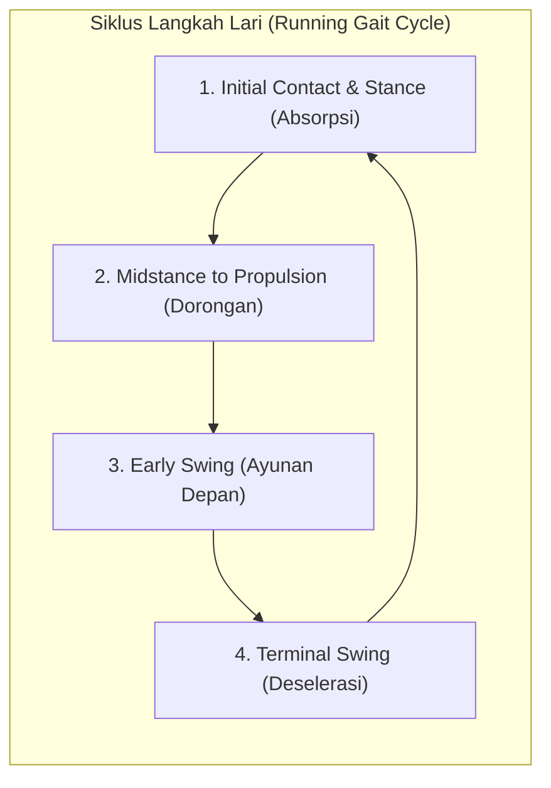
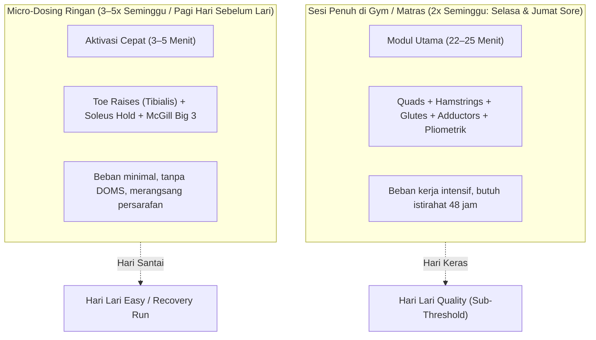

# Semua Otot Utama yang Terdampak Saat Lari + Strength Training (Lengkap)

* **Status Validasi**: Referensi Fisiologi & Biomekanika Otot Resmi untuk Skill `/strength-guide` dan Sistem Kepelatihan `intervals-icu-mcp`.
* **Konteks Atlet**: Pelari Jarak Jauh (Bobot 70–80 kg, Proteksi Postur Inti & Stabilitas Tulang Belakang Lumbar, Target Lomba 10K/Half Marathon).

---

## 1. Ringkasan Matriks 8 Kelompok Otot Pelari

Tabel referensi berikut merangkum 8 kelompok otot utama yang bekerja keras selama siklus lari (*running gait cycle*), jenis latihan kekuatan fungsional yang direkomendasikan, frekuensi ideal, dan fokus kinematika gerakannya:

| No | Nama Otot | Jenis Strength Training | Frekuensi Latihan | Gambar Gerakan / Pola Kinematika |
|:--:|---|---|:---:|---|
| **1** | **Quadriceps (Paha Depan)** | Squats, Lunges, Leg Press, Step-up | **2–3x seminggu** | *Bodyweight Squat / Knee Extension* |
| **2** | **Hamstring (Paha Belakang)** | Romanian Deadlift (RDL), Nordic Curl, Hamstring Curl | **2–3x seminggu** | *Hip Hinge / Romanian Deadlift* |
| **3** | **Gluteus Maximus & Medius** | Hip Thrust, Glute Bridge, Side-lying Leg Raise, Clamshell | **2–3x seminggu** | *Hip Thrust on Bench / Pelvic Drive* |
| **4** | **Gastrocnemius & Soleus (Betis)** | Standing Calf Raise, Seated Calf Raise, Jump Rope | **3–4x seminggu / daily** | *Standing Calf Raise (Jinjit Vertikal)* |
| **5** | **Iliopsoas / Psoas (Hip Flexor)** | Hanging Leg Raise, Mountain Climbers, Psoas March, Reverse Lunge | **2–3x seminggu** | *Hanging Leg Raise (Fleksi Panggul >90°)* |
| **6** | **Tibialis Anterior (Otot Shin)** | Toe Raises, Heel Walks, Band Dorsiflexion | **3–5x seminggu / daily** | *Toe Raises / Heel Walks (Dorsofleksi)* |
| **7** | **Adductors (Otot Dalam Paha)** | Side Lunge, Copenhagen Plank, Sumo Squat | **2–3x seminggu** | *Wide-Stance Sumo Squat / Lateral Lunge* |
| **8** | **Core + Erector Spinae** | Plank, Side Plank, Dead Bug, Bird Dog, Russian Twist | **4–5x seminggu / daily** | *Forearm Plank (Anti-Extension Core)* |

---

## 2. Analisis Biomekanika & Kinematika per Kelompok Otot

### 1. Quadriceps (Paha Depan — *Rectus Femoris, Vastus Lateralis, Vastus Medialis, Vastus Intermedius*)
* **Peran Kinematika**: Bekerja secara eksentrik pada fase kontak awal (*initial contact*) untuk menyerap benturan pendaratan kaki, lalu berkontraksi konsentrik untuk ekstensi lutut saat mendorong ke depan.
* **Risiko Cedera**: *Patellofemoral Pain Syndrome* (Runner's Knee), tendinopati patela, dan ketidakseimbangan kekuatan dengan hamstring.
* **Latihan Terpilih**: 
  * *Controlled Air Squat (Tempo 3-1-1)*: Menekankan kontrol eksentrik 3 detik tanpa membiarkan pinggang melengkung (*butt wink*).
  * *Reverse Lunges*: Melangkah mundur untuk mengurangi gaya geser (*shear force*) pada tempurung lutut.
* **Korelasi Atlet (81 kg)**: Mengingat beban tubuh 81 kg menghasilkan gaya benturan hingga 200–240 kg per langkah, quadriceps yang kuat berfungsi sebagai peredam kejut alami agar sendi lutut tidak aus.

---

### 2. Hamstring (Paha Belakang — *Biceps Femoris, Semitendinosus, Semimembranosus*)
* **Peran Kinematika**: Melakukan deselerasi eksentrik ayunan tungkai bawah di udara sebelum mendarat (*terminal swing phase*), dan membantu ekstensi panggul saat dorongan akhir.
* **Risiko Cedera**: Robekan atau tarikan hamstring (*hamstring strain*), tendinopati proksimal hamstring di area tulang duduk (*ischial tuberosity*).
* **Latihan Terpilih**:
  * *Single-Leg Romanian Deadlift (SL-RDL)*: Melatih kontrol panggul tunggal (*hip hinge*) dan kekuatan eksentrik hamstring.
  * *Nordic Hamstring Curl*: Standar emas pencegahan cedera hamstring di dunia olahraga elit.
* **Korelasi Atlet**: Menjaga rasio kekuatan Hamstring:Quadriceps (H:Q ratio) minimal 0.60–0.70 untuk mencegah hamstring tertarik saat membuka langkah cepat (*finish kick* Semarang 10K).

---

### 3. Gluteus Maximus & Medius (Bokong & Panggul Luar)
* **Peran Kinematika**:
  * *Gluteus Maximus*: Mesin pendorong horizontal utama (*primary driver*) ekstensi panggul.
  * *Gluteus Medius*: Penstabil bidang frontal panggul. Mengunci panggul agar tidak miring turun ke sisi berlawanan (*contralateral hip drop / Trendelenburg sign*) saat tubuh bertumpu pada satu kaki.
* **Risiko Cedera**: IT Band Syndrome (ITBS), trochanteric bursitis, ketidakstabilan panggul yang memicu nyeri punggung bawah (*LBP*).
* **Latihan Terpilih**:
  * *Glute Bridge March*: Memperkuat gluteus maximus sekaligus melatih stabilitas rotasi panggul.
  * *McGill Side Plank*: Mengisolasi gluteus medius dan quadratus lumborum (QL) tanpa gerakan fleksi tulang belakang.
  * *Clamshell & Side-Lying Leg Raise*: Aktivasi pra-lari untuk membangunkan otot panggul yang tertidur akibat duduk lama.

---

### 4. Gastrocnemius & Soleus (Betis & Pegas Tendon Achilles)
* **Peran Kinematika**:
  * *Gastrocnemius* (melewati dua sendi: lutut & pergelangan kaki): Menghasilkan daya dorong eksplosif dan dorsofleksi lutut.
  * *Soleus* (hanya melewati sendi pergelangan kaki, didominasi serat Type I lambat): **Penyangga beban lari terbesar (hingga 6–8x berat badan)** pada lari jarak jauh, bekerja terus-menerus menahan gravitasi.
* **Risiko Cedera**: *Achilles Tendinopathy*, robekan betis medial (*tennis leg*), dan *plantar fasciitis*.
* **Latihan Terpilih**:
  * *Standing Calf Raise*: Lutut lurus untuk menargetkan Gastrocnemius.
  * *Bent-Knee Soleus Wall Hold / Seated Calf Raise*: Lutut ditekuk ~45–90° untuk mengisolasi Soleus secara spesifik.
  * *Pogo Jumps*: Melatih elastisitas pegas tendon Achilles (*tendon stiffness*).
* **Korelasi Sepatu Plat Karbon/Nylon**: Sepatu berpelat seperti Saucony Endorphin Speed 5 menuntut stabilitas dan kekuatan dorongan soleus yang tinggi agar tidak terjadi kelelahan dini pada pergelangan kaki.

---

### 5. Iliopsoas / Psoas (Hip Flexor / Fleksor Panggul)
* **Peran Kinematika**: Menarik paha ke depan dan ke atas (*hip flexion & knee drive*) pada fase ayun, mengontrol frekuensi langkah (kadens ≥ 175 rpm).
* **Risiko Cedera**: *Psoas impingement*, tarikan fleksor panggul, dan tarikan anterior berlebih pada tulang belakang lumbal.
* **Latihan Terpilih**:
  * *Standing High-Knee Isometric Hold*: Menahan lutut di atas 90° selama 8–10 detik untuk membangun kekuatan isometrik psoas tanpa membungkukkan badan.
  * *Half-Kneeling Hip Flexor Stretch with Glute Squeeze*: Membuka ketegangan psoas dengan memutar panggul ke posisi posterior tilt lembut.
* **Korelasi Atlet (Flat Lumbar)**: Otot psoas yang kaku dan pendek akibat duduk lama akan menarik tulang belakang lumbal ke depan (*anterior shear*). Peregangan dan penguatan isometrik adalah kunci bebas nyeri pinggang.

---

### 6. Tibialis Anterior (Otot Tulang Kering / Shin)
* **Peran Kinematika**: Melakukan dorsofleksi pergelangan kaki (mengangkat jari kaki ke atas) saat fase ayun agar kaki tidak tersandung, serta mengontrol deselerasi telapak kaki saat mendarat (*eccentric foot slap control*).
* **Risiko Cedera**: **Medial Tibial Stress Syndrome (MTSS / Shin Splints)**, kompartemen sindrom anterior.
* **Latihan Terpilih**:
  * *Toe Raises*: Bersandar di dinding, angkat ujung jari kaki setinggi mungkin sambil bertumpu pada tumit (2–3 set × 15–20 repetisi).
  * *Heel Walks*: Berjalan menggunakan tumit dengan jari kaki terangkat selama 30–45 detik.
  * *Band Dorsiflexion*: Menarik resistance band ke arah tubuh.
* **Korelasi Frekuensi**: Karena bersifat postural dan berdaya tahan tinggi, otot ini sangat aman dilatih dengan frekuensi tinggi (**3–5x seminggu atau harian** sebagai bagian dari pemanasan pra-lari).

---

### 7. Adductors (Otot Bagian Dalam Paha — *Adductor Magnus, Longus, Brevis, Gracilis*)
* **Peran Kinematika**: Bersama gluteus medius, adductors bertindak sebagai pengunci cincin panggul (*pelvic ring stability*), mencegah femur bergoyang ke lateral atau medial saat fase tumpuan satu kaki.
* **Risiko Cedera**: *Groin pull / strain*, osteitis pubis, nyeri selangkangan.
* **Latihan Terpilih**:
  * *Copenhagen Plank (Modifikasi Lutut)*: Bertumpu pada siku dan bagian dalam lutut/kaki di atas bangku atau lantai untuk mengunci adductor secara isometrik (2 set × 15–20 detik/sisi).
  * *Side Lunge (Lateral Lunge)*: Melatih mobilitas frontal dan kekuatan adductor eksentrik.
  * *Sumo Squat*: Mengaktifkan rantai adductor bersama gluteus.

---

### 8. Core + Erector Spinae (Batang Tubuh & Penegak Tulang Belakang)
* **Peran Kinematika**: Batang tubuh adalah fondasi transmisi gaya. Core yang kaku (*stiff core*) mencegah energi bocor (*energy leakage*) saat kaki menghantam tanah, dan mempertahankan postur tegak pelari di kilometer akhir (*Stay Tall When Tired*).
* **Risiko Cedera**: Nyeri punggung bawah (*Lower Back Pain / LBP*), herniasi diskus, kompresi lumbal.
* **Latihan Terpilih (McGill Big 3 & Safe Core)**:
  * *McGill Modified Curl-Up*: Tangan menyangga lekukan lumbal, satu lutut ditekuk, angkat dada 2–3 cm tanpa melengkungkan pinggang.
  * *McGill Side Plank*: Mengunci otot samping panggul dan pinggang.
  * *Bird-Dog*: Menyilangkan tangan dan kaki berlawanan, melatih erector spinae dan multifidus dengan beban kompresi tulang belakang minimal (<3000 N).
  * *Dead Bug*: Menjaga punggung bawah menempel rata di lantai (*anti-extension*).
* **Korelasi Atlet (Flat Lumbar)**: Dilarang keras melakukan gerakan *sit-up*, *crunches*, atau *Russian twist* dengan beban berat karena gerakan fleksi-rotasi berulang dapat memicu kerusakan diskus lumbal atlet.

---

## 3. Protokol Penjadwalan: *Daily Micro-Dosing vs Quality Days*

Untuk mematuhi aturan emas Steve Magness (*"Hard Days Hard, Easy Days Easy"*) dan memaksimalkan adaptasi tanpa risiko kelelahan:

1. **Sesi Penuh (22–25 Menit) — Selasa & Jumat Sore (Pasca Lari Sub-Threshold)**:
   * Meliputi latihan beban tungkai bawah (Squat, RDL, Glute Bridge, Reverse Lunge, Copenhagen Plank) dan pliometrik (Pogo Jumps).
2. **Micro-Dosing Pra-Lari (3–5 Menit) — Setiap Hari Latihan**:
   * Meliputi: *Toe Raises* (15 reps untuk Tibialis Anterior), *Bent-Knee Calf Raise* (15 reps untuk Soleus), dan *Bird-Dog* (4 reps per sisi untuk mengaktifkan core).

---

## 4. Rangkuman Aplikasi Taktis Menuju Semarang 10K (13 Des 2026)

* **Target Lomba**: Semarang 10K (Sub-60 Plan A, rute datar pesisir).
* **Kebutuhan Otot**:
  * Lomba 10K membutuhkan **efisiensi langkah dan kadens stabil (≥175 rpm)** selama ~55–60 menit.
  * Otot **Tibialis Anterior** dan **Soleus** yang terlatih mencegah kelelahan kaki bawah (*foot fatigue*) di KM 7–10.
  * Otot **Gluteus Medius** dan **Adductors** yang seimbang menjaga langkah tetap lurus dan simetris, menghemat energi hingga 2%–3% (*improved running economy*).
  * Otot **Core/Erector Spinae** memastikan tubuh tidak membungkuk saat menyentuh garis finish di Kota Lama Semarang.
