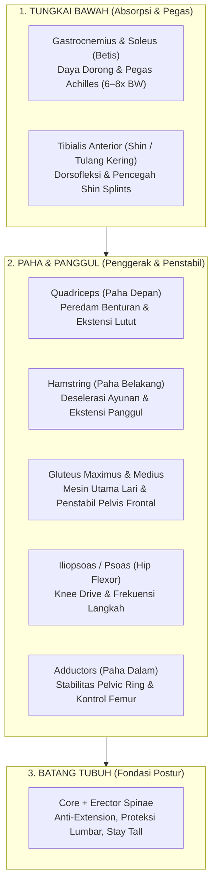

# Running Anatomy & Muscle Armor for Endurance Runners

Koleksi literatur ini mendokumentasikan anatomi fungsional, biomekanika langkah lari (*running gait cycle*), serta panduan penguatan 8 kelompok otot utama yang terdampak saat berlari. Digunakan sebagai landasan sains untuk skill `/strength-guide` dan proteksi muskuloskeletal pelari.

---

## 📑 Daftar Berkas Literatur

1. [**`01-semua-otot-utama-saat-lari-dan-strength-training.md`**](./01-semua-otot-utama-saat-lari-dan-strength-training.md)  
   *Panduan Komprehensif: 8 Kelompok Otot Utama, Peran Kinematika Fase Langkah, Risiko Cedera Spesifik, Latihan Beban Terpilih, dan Frekuensi Latihan Ideal.*

---

## 🎯 8 Kelompok Otot Kunci Pelari

---

## 🔗 Hubungan dengan Sistem Kepelatihan
- **Skill Terkait**: [`.agents/skills/panduan-kekuatan/SKILL.md`](../../.agents/skills/panduan-kekuatan/SKILL.md)
- **Guardrails**: [`.agents/rules/norwegian-singles-guardrails.md`](../../.agents/rules/norwegian-singles-guardrails.md)
- **Konteks Fisiologis**: Proteksi muskuloskeletal rantai kinetik tungkai bawah dan stabilitas tulang belakang (McGill Big 3).
