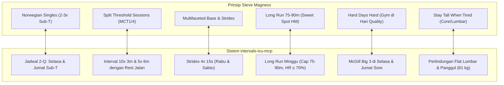

# Steve Magness Endurance Performance Reference Library

Koleksi dokumentasi ilmiah dan panduan praktis hasil kurasi dari video-video edukasi **Steve Magness** (Endurance Coach, mantan pelari sub-4 mil, sport scientist, dan penulis *The Science of Running* & *Do Hard Things*).

Dokumen-dokumen ini berfungsi sebagai **bukti ilmiah pembanding (*cross-confirmation*)** yang memvalidasi keputusan metodologi, aturan guardrails, dan eksekusi skills di dalam ekosistem **`intervals-icu-mcp`**.

---

## 📚 Daftar Referensi Lengkap

| No | File Dokumen | Judul Video Asli | Topik Utama | Relevansi Skill MCP |
|:---:|---|---|---|---|
| **1** | [`01-norwegian-singles-deep-dive.md`](./01-norwegian-singles-deep-dive.md) | *The Best Training for Amateurs? \| Norwegian Singles Deep Dive* | Adaptasi Sub-Threshold untuk pelari amatir, kontrol laktat (2.5–3.5 mmol/L), dan penyeimbang neuromuskular. | `/calc-nsa`, `/plan-week`, `running-coach-analysis` |
| **2** | [`02-boost-lactate-threshold-guide.md`](./02-boost-lactate-threshold-guide.md) | *How To Boost Your Lactate Threshold \| Step-By-Step Guide* | Fisiologi laktat modern, peran transporter MCT1 & MCT4, split threshold sessions, dan alternations. | `/calc-nsa`, `/calc-vdot`, `/run-report` |
| **3** | [`03-build-killer-base-guide.md`](./03-build-killer-base-guide.md) | *How to Build a Killer Base \| Your Comprehensive Guide* | Konsep *Multifaceted Base* (menggabungkan mesin aerobik, strides, hill sprints, dan penguatan struktur). | `/weekly-budget`, `/plan-week`, `running-coach-analysis` |
| **4** | [`04-truth-about-long-runs.md`](./04-truth-about-long-runs.md) | *The Truth About Long Runs \| Your Comprehensive Guide* | Penghematan glikogen, rekrutmen serat otot cepat saat lelah, batas kritis *diminishing returns* (75–90m untuk HM). | `/plan-week`, `training-load-analysis` |
| **5** | [`05-strength-training-for-runners.md`](./05-strength-training-for-runners.md) | *Strength Training for Runners: A Practical Guide* | Menghancurkan mitos beban, tujuan *"Stay Tall When Tired"*, 5 alat gym pelari, dan aturan *"Hard Days Hard"*. | `norwegian-singles-guardrails`, `project-context` |

---

## 🔬 Matriks Validasi Silang (*Cross-Confirmation Matrix*)

Seluruh prinsip yang diajarkan oleh Steve Magness dalam 5 video di atas **selaras 100% dengan rancangan sistem kepelatihan lari jarak jauh berbasis sains**:

---

## 🎯 Manfaat Langsung untuk Pengembangan Atlet

1. **Kepastian Sains (Zero Guesswork)**: Setiap kali menjalankan sesi latihan (apakah itu 5x 6m di hari Jumat, lari santai 45m di hari Kamis, atau McGill Big 3 di sore hari), Anda tahu persis mekanisme molekuler dan fisiologis di baliknya.
2. **Kepatuhan Terhadap Batas Fisiologis**: Peringatan Steve tentang bahaya lari terlalu kencang di sesi threshold atau terlalu lama di sesi long run menjadi pelindung utama Anda dari cedera menjelang **Malioboro Run Half Marathon (4 Oktober 2026)**.
